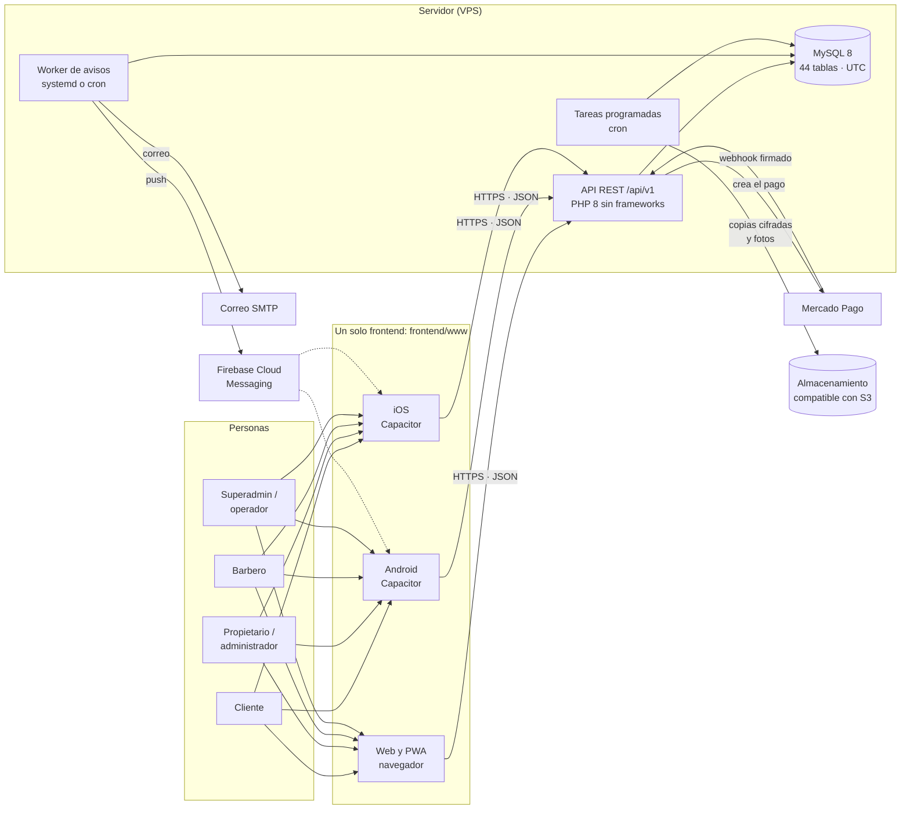
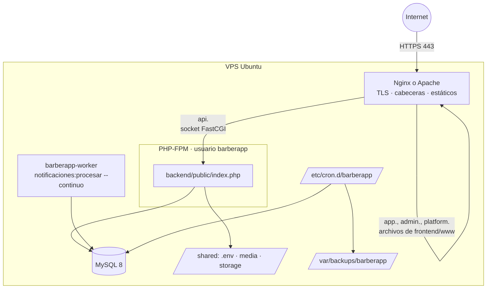
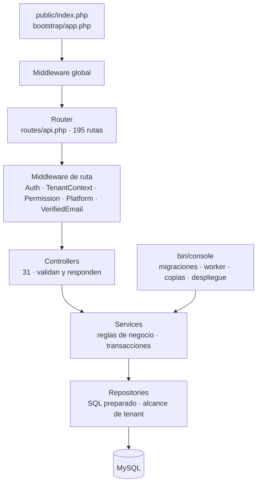
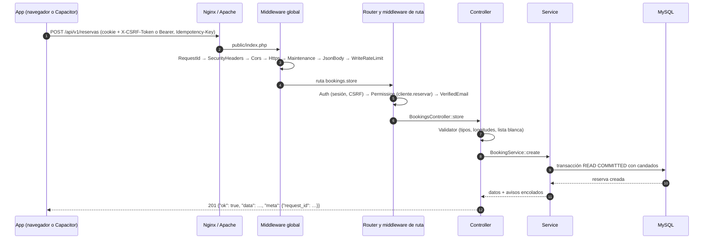
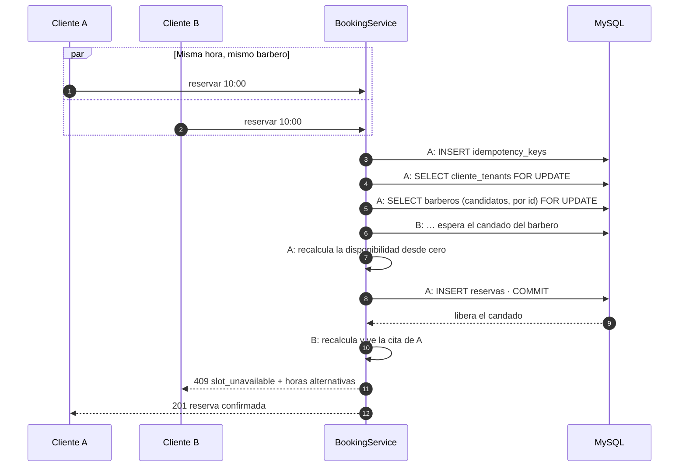
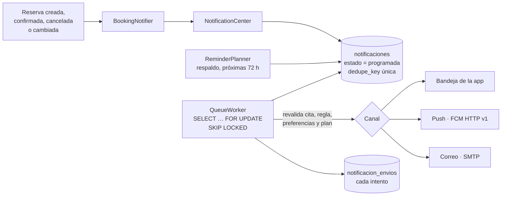
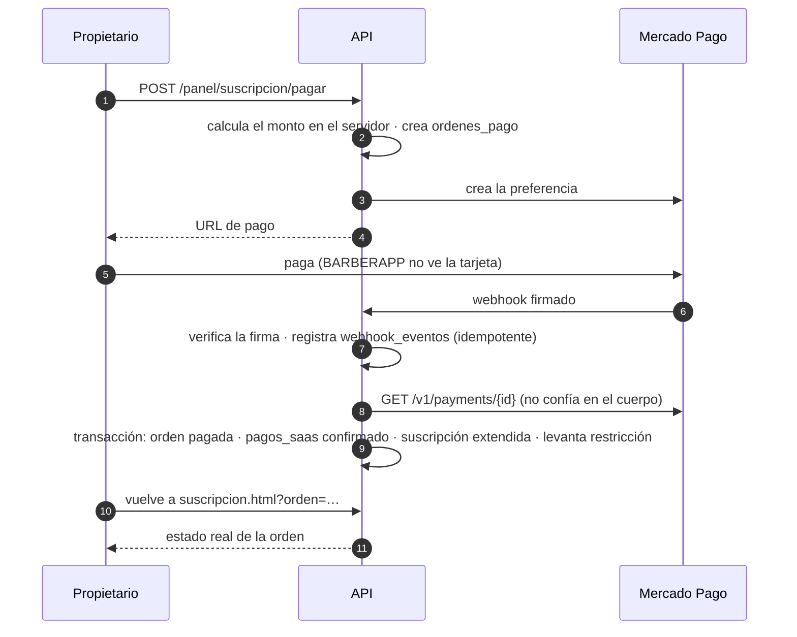

# Arquitectura de BARBERAPP

Cómo está construido BARBERAPP y cómo se mueven los datos, de la pantalla a la base y a los servicios externos. Los diagramas usan Mermaid: GitHub los muestra directamente; en local, VS Code con *Markdown Preview Mermaid Support* o https://mermaid.live.

| Tema | Documento |
|---|---|
| Modelo de datos | [MODELO_ER.md](MODELO_ER.md) y [DICCIONARIO_DATOS.md](DICCIONARIO_DATOS.md) |
| API | [API.md](API.md) y [api/openapi.json](api/openapi.json) |
| Por qué se eligió cada cosa | [DECISIONES.md](DECISIONES.md) |
| Servidor de producción | [DESPLIEGUE.md](DESPLIEGUE.md) |

## Contenido

1. [Vista general](#1-vista-general)
2. [Despliegue en producción](#2-despliegue-en-producción)
3. [Backend por capas](#3-backend-por-capas)
4. [Ciclo de una petición](#4-ciclo-de-una-petición)
5. [Multiempresa (tenants)](#5-multiempresa-tenants)
6. [Reservas sin doble reserva](#6-reservas-sin-doble-reserva)
7. [Avisos y recordatorios](#7-avisos-y-recordatorios)
8. [Pagos de la suscripción](#8-pagos-de-la-suscripción)
9. [Frontend, PWA y apps](#9-frontend-pwa-y-apps)
10. [Tareas programadas, copias y monitoreo](#10-tareas-programadas-copias-y-monitoreo)
11. [Decisiones principales](#11-decisiones-principales)
12. [Estructura de carpetas](#12-estructura-de-carpetas)
13. [Seguridad por capas](#13-seguridad-por-capas)

## 1. Vista general



- **Un frontend, cuatro públicos.** Las pantallas del cliente, del panel de la barbería, del barbero y de la plataforma están en el mismo `frontend/www`, que se publica como web, se instala como PWA y se empaqueta como app con Capacitor.
- **Un backend.** Monolito modular en PHP 8.0+ sin frameworks: una API REST, un worker de avisos y comandos de consola, todos sobre la misma base MySQL 8.
- **Servicios externos opcionales.** Firebase (push), SMTP (correo), Mercado Pago (cobro de planes) y un bucket S3 (copias). Sin ellos, la aplicación funciona: los avisos quedan en la bandeja, los cobros se registran a mano y las copias se quedan en el servidor.

## 2. Despliegue en producción



| Dominio (referencial) | Sirve |
|---|---|
| `app.barberapp.pe` | Clientes, marketplace, enlace directo `/b/{slug}`, PWA |
| `admin.barberapp.pe` | Panel de la barbería (mismo frontend; otra página de inicio) |
| `platform.barberapp.pe` | Panel de la plataforma, opcionalmente solo desde ciertas IP |
| `api.barberapp.pe` | API REST y fotos (`/media`) |

Cada versión se publica en `releases/<fecha>-<commit>` y `current` apunta a la que atiende. `desplegar.sh` revisa la versión nueva, activa el mantenimiento y hace una copia si hay migraciones. Si la salud falla, vuelve atrás solo. El código es de `root` y PHP corre con su propio usuario, así que PHP no puede modificarlo. Detalle: [DESPLIEGUE.md](DESPLIEGUE.md).

## 3. Backend por capas



| Capa | Responsabilidad | Ejemplos |
|---|---|---|
| `Core/` | Infraestructura propia: arranque, router, petición y respuesta, PDO, configuración, registro, migraciones | `Router`, `Database::transaction`, `Migrator` |
| `Middleware/` | Lo que se aplica antes del controlador | `AuthMiddleware`, `TenantContextMiddleware`, `PermissionMiddleware` |
| `Controllers/` | Leer la petición, validar con `Validator` (lista blanca de campos) y delegar | `BookingsController`, `PanelAgendaController` |
| `Services/` | Reglas de negocio, transacciones y candados, avisos, auditoría | `Booking/BookingService`, `Billing/PaymentProcessor`, `Notifications/QueueWorker` |
| `Repositories/` | Consultas SQL; las de una barbería reciben el `tenant_id` al construirse | `TenantScopedRepository`, `AgendaRepository` |
| `Helpers/` | Utilidades sin estado | `Validator`, `Clock` (UTC), `TrustedProxies` |

Grupos de servicios: `Auth`, `Booking`, `Schedule` (jornadas y bloqueos), `Panel`, `Barber`, `Marketplace`, `Catalog`, `Media`, `Qr`, `Notifications`, `Billing`, `Platform`, `Reports`, `Privacy`, `Backup`, `Ops`, `Security` y `Docs` (la documentación generada de la Fase 16). Las carpetas `Jobs/`, `Models/` y `Policies/` están reservadas y vacías: el trabajo en segundo plano vive en comandos de consola y servicios, y las reglas de acceso en los middleware y en `BookingRules`.

El backend no tiene dependencias de producción: corre sin Composer, con un autoloader PSR-4 propio. Composer solo instala PHPUnit para las pruebas.

## 4. Ciclo de una petición



1. El servidor web entrega todo a `public/index.php`, que carga `.env`, la configuración y las rutas.
2. **Middleware global**, en este orden:
   - `RequestId`: identificador de la petición, devuelto en `X-Request-Id`.
   - `SecurityHeaders`: CSP, `nosniff`, `X-Frame-Options`, HSTS.
   - `Cors`: lista blanca de orígenes.
   - `Https`: redirige o rechaza HTTP en producción.
   - `Maintenance`: 503 durante un despliegue.
   - `JsonBody`: tamaño máximo y JSON válido.
   - `WriteRateLimit`: escrituras por IP.
3. **Router:** 404, o 405 con `Allow`. Luego el middleware de la ruta:
   - `Auth`: cookie y CSRF, o Bearer.
   - `TenantContext`: barbería y membresía.
   - `Permission`: permiso del rol, uno o alguno de varios.
   - `Platform`: rol de plataforma.
   - `VerifiedEmail`: correo verificado.
4. El controlador valida y delega en un servicio, que decide y escribe dentro de una transacción.
5. Toda excepción se convierte en el sobre de error por `ExceptionHandler`. Los 5xx se registran sin datos sensibles y, en producción, sin detalles para el cliente.

El sobre, la autenticación, la paginación y los códigos de error están en [API.md](API.md).

## 5. Multiempresa (tenants)

- **Base de datos compartida:** `tenant_id` en cada tabla de negocio y **claves foráneas compuestas** `(tenant_id, x_id)`. Así, una reserva no puede apuntar al barbero de otra barbería ni por error ni a propósito, porque la base lo impide.
- **La barbería nunca la decide el cliente:** `TenantContextMiddleware` la resuelve por *slug* (`X-Tenant` o la elegida con `POST /me/context`) y comprueba en la base que la persona tenga una membresía activa con ese rol.
- **Repositorios con alcance:** `TenantScopedRepository` recibe el `tenant_id` del contexto verificado al construirse. Las consultas no lo reciben como parámetro.
- **Permisos por rol y por barbería:** una misma cuenta puede ser barbero en una barbería y administradora en otra. Los permisos se calculan para la barbería activa.
- **Plataforma aparte:** el superadministrador no tiene permisos dentro de las barberías. Ve cifras agregadas, no clientes ni agendas.

La matriz completa rol × ruta se prueba en cada ejecución: [MATRIZ_ACCESO.md](MATRIZ_ACCESO.md).

## 6. Reservas sin doble reserva



- **Una transacción `READ COMMITTED`** con un orden fijo de candados: la clave de idempotencia, luego el cliente y luego los barberos candidatos ordenados por id (para que dos transacciones no se bloqueen entre sí).
- **Se recalcula con los candados tomados.** La disponibilidad que vio la pantalla es solo una sugerencia; la decisión se toma dentro de la transacción.
- **Idempotencia:** la misma `Idempotency-Key` devuelve la misma respuesta, aunque las dos peticiones lleguen a la vez.
- Las mismas reglas valen para el panel (alta manual, reprogramar) y para los cambios de jornada y bloqueos, que toman el mismo candado del barbero.

`ConcurrencyTest` lo prueba con procesos PHP reales que reservan al mismo tiempo. Detalle: [RESERVAS.md](RESERVAS.md#por-qué-no-puede-haber-doble-reserva).

## 7. Avisos y recordatorios



- **Cola persistente en MySQL**, sin servicios externos de colas.
- **El worker corre como servicio permanente** (`notificaciones:procesar --continuo` con systemd), o cada minuto por cron en hosting sin systemd. Varios workers pueden correr a la vez: `SKIP LOCKED` evita que dos envíen el mismo aviso.
- Antes de enviar, el worker **vuelve a comprobar** que la cita siga igual, que la regla siga activa y que la persona no haya apagado ese canal. Reintenta con espera creciente y desactiva los tokens que FCM rechaza.
- Entrega "al menos una vez": un aviso puede repetirse en el peor caso, pero nunca se pierde.

Detalle: [RECORDATORIOS.md](RECORDATORIOS.md).

## 8. Pagos de la suscripción



Si el monto no coincide o la orden ya estaba pagada, el pago queda **en revisión** para el equipo de la plataforma. Detalle: [MONETIZACION.md](MONETIZACION.md).

## 9. Frontend, PWA y apps

- **HTML, CSS y JavaScript ES6 sin compilar.** Cada pantalla es un `.html` con su módulo en `js/pages/`. Los módulos compartidos son `api.js` (sobre, CSRF, reintentos, renovación de tokens), `ui.js`, `shell.js` y `native.js` (el adaptador de Capacitor).
- **Textos seguros:** todo dato se escribe con `textContent` o escapado. Las pruebas E2E siembran cargas XSS en los datos y fallan si alguna se interpreta como HTML.
- **PWA:** `manifest.webmanifest` y un service worker que guarda solo archivos estáticos, nunca respuestas de la API.
- **Apps:** Capacitor 8 con el mismo `www/`. En la app, la sesión es un access token de 15 minutos más un refresh token rotativo guardado en el llavero del sistema; en la web, una cookie `HttpOnly` con CSRF. Guías: [Android](guias/ANDROID.md) e [iOS](guias/IOS.md).
- **La URL de la API** se calcula sola en local, la escribe `despliegue:frontend` en un servidor y `npm run configurar` en las apps.

## 10. Tareas programadas, copias y monitoreo

| Tarea | Cuándo | Qué hace |
|---|---|---|
| `notificaciones:procesar --continuo` | Permanente (systemd) | Envía avisos y recordatorios |
| `suscripciones:vencer` | Cada hora | Cambios de plan programados, vencimientos, restricción y avisos |
| `monitor:revisar --alertar` | Cada 5 minutos | Base, migraciones, cola, tareas, copias, disco, errores y HTTPS; avisa por correo |
| `backup:crear`, `backup:enviar` | Diaria | Copia cifrada y envío fuera del servidor |
| `backup:verificar` | Semanal | Restauración de prueba |
| `privacidad:retencion`, `auth:purge`, `reservas:purge`, `notificaciones:purge`, `logs:purge` | Diaria | Retención de datos (Ley 29733) y limpieza |

Cada tarea deja un latido. `monitor:revisar` y `GET /health/operacion` avisan cuando una deja de correr. Procedimiento de copias: [BACKUPS.md](BACKUPS.md).

## 11. Decisiones principales

- **Monolito modular** en PHP puro, sin microservicios: un único despliegue, fácil de operar en XAMPP y en un VPS.
- **API REST JSON versionada** en `/api/v1`, con sobre uniforme y códigos de error estables.
- **Multiempresa con base compartida** y claves foráneas compuestas (sección 5).
- **Tiempo en UTC** en el servidor y en MySQL. Cada sucursal guarda su zona horaria (por defecto `America/Lima`) para la agenda.
- **Migraciones SQL versionadas** con checksum. `database/schema.sql` se genera a partir de ellas.
- **Trabajo en segundo plano con la propia base:** cola en MySQL, un worker permanente con systemd (o cron cada minuto donde no hay systemd) y tareas por cron, sin servicios de colas externos.
- **Documentación generada desde el código:** OpenAPI desde las rutas reales, el diccionario y los diagramas ER desde la base migrada, y la matriz de pruebas desde los archivos de pruebas. La CI falla si quedan desactualizados.

La lista completa, con el porqué de cada una: [DECISIONES.md](DECISIONES.md).

## 12. Estructura de carpetas

```text
barberapp/
├── backend/
│   ├── public/              ← único directorio expuesto: index.php, .htaccess, media/
│   ├── bootstrap/           ← autoload.php (PSR-4 propio) y app.php (arranque y middleware global)
│   ├── config/              ← app, auth, backup, billing, cors, database, mail, media, notifications, ops, privacy, security
│   ├── routes/api.php       ← las 195 rutas de /api/v1 con nombre y middleware
│   ├── app/
│   │   ├── Core/            ← Application, Router, Request, Response, Database, Env, Config, Pipeline, ExceptionHandler, Logger, Migrator
│   │   ├── Middleware/      ← 12 middleware globales y de ruta
│   │   ├── Controllers/     ← 31 controladores
│   │   ├── Services/        ← reglas de negocio por dominio (ver sección 3)
│   │   ├── Repositories/    ← consultas SQL; TenantScopedRepository
│   │   └── Helpers/         ← Validator, Clock, Codes, Slug, Tokens, Ip, TrustedProxies, Media
│   ├── database/
│   │   ├── migrations/      ← 0001…0016 *.sql
│   │   ├── seeds/           ← CatalogSeeder (todos los entornos), DemoSeeder (solo local/testing)
│   │   └── schema.sql       ← script completo generado
│   ├── bin/console          ← CLI: base, migraciones, worker, copias, despliegue, documentación…
│   ├── storage/             ← logs, correo y push de prueba, latidos, copias (fuera de public/)
│   └── tests/               ← PHPUnit: Unit/ e Integration/
├── frontend/
│   ├── www/                 ← HTML, CSS y JS compartidos (web, PWA, Capacitor)
│   ├── android/, ios/       ← proyectos nativos de Capacitor
│   ├── e2e/                 ← pruebas Playwright
│   └── scripts/             ← configurar la app, recursos, verificar la PWA, capturas de los manuales
├── infrastructure/          ← Nginx, Apache, PHP-FPM, cron, systemd, logrotate, well-known, XAMPP y scripts de instalación, despliegue y rollback
├── docs/                    ← esta documentación (índice: docs/README.md)
│   └── fuente/              ← fichas de la API y matriz de pruebas que alimentan los documentos generados
└── .github/workflows/       ← integración continua (calidad.yml)
```

## 13. Seguridad por capas

| Capa | Medidas |
|---|---|
| Red y servidor | HTTPS con HSTS, solo `backend/public` expuesto, PHP con usuario propio sin permiso de escribir el código, `.env` con permisos 640, cortafuegos |
| HTTP | CORS por lista blanca, CSP sin scripts en línea, `X-Frame-Options: DENY`, `nosniff`, límite de tamaño, límite de escrituras por IP |
| Sesión | Cookie `HttpOnly`, `Secure` y `SameSite=Lax` con CSRF; tokens de app cortos con refresh rotativo y detección de reutilización; revocación inmediata |
| Acceso | Permisos por rol y barbería verificados en cada ruta; contexto de barbería resuelto en el servidor; matriz rol × ruta probada |
| Datos | SQL siempre preparado, sin emulación ni multi-statements; `sql_mode` estricto; claves foráneas compuestas; auditoría solo de inserción |
| Personas (Ley 29733) | Eliminar cuenta, descargar datos, derechos ARCO, textos legales versionados, retención automática |
| Copias | AES-256-GCM, SHA-256, prueba de restauración semanal y copia fuera del servidor |

Detalle y lista previa a publicar: [SEGURIDAD.md](SEGURIDAD.md).
