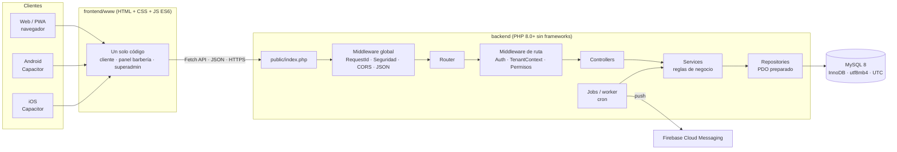

# Arquitectura de BARBERAPP

## Visión general



## Decisiones principales

- **Monolito modular** en PHP puro, sin microservicios. Un único despliegue fácil de operar en XAMPP (desarrollo) y en un VPS con Apache/Nginx + PHP-FPM (producción).
- **API REST JSON versionada** en `/api/v1`. Sobre de respuesta uniforme:
  - éxito `{"ok": true, "data": …, "meta": {"request_id": "…"}}`
  - error `{"ok": false, "error": {"code": "…", "message": "…", "details": {…}}, "meta": {…}}`
  - `code` es estable (p. ej. `validation_failed`, `tenant_inactive`) para que el frontend reaccione sin depender del texto.
- **Multitenancy con base de datos compartida**: `tenant_id` en cada tabla de negocio, FK compuestas `(tenant_id, id)` y `TenantContextMiddleware` que resuelve la barbería por *slug* (ruta `/b/{tenant}/…` o cabecera `X-Tenant`) y verifica la membresía del usuario. Nunca se acepta un `tenant_id` enviado por el cliente.
- **Repositorios con alcance de tenant** (`TenantScopedRepository`): el `tenant_id` se fija al construir el repositorio, a partir del contexto verificado.
- **Tiempo**: el servidor y la conexión MySQL trabajan en UTC. Cada sucursal guarda su `zona_horaria` (por defecto `America/Lima`) para convertir horarios locales.
- **Migraciones SQL versionadas** (`database/migrations/NNNN_*.sql`), aplicadas por `php bin/console migrate` y registradas con checksum en `migraciones`. `database/schema.sql` se genera a partir de ellas.
- **Trabajo en segundo plano con cron**: los avisos se guardan en una cola en MySQL y los envía `php bin/console notificaciones:procesar` cada minuto (sin colas externas ni procesos persistentes). Ver [RECORDATORIOS.md](RECORDATORIOS.md).
- **Sin dependencias de producción**: el backend corre sin Composer (autoloader PSR-4 propio). Composer solo instala PHPUnit 9.6 (compatible con PHP 8.0) para pruebas.

## Estructura de carpetas

```text
barberapp/
├── backend/
│   ├── public/            ← único directorio expuesto por el servidor web
│   │   ├── index.php      ← front controller
│   │   └── .htaccess      ← reescritura a index.php
│   ├── bootstrap/         ← autoload.php (PSR-4 sin Composer) y app.php (arranque)
│   ├── config/            ← app.php, database.php, cors.php (leen .env)
│   ├── routes/api.php     ← definición de rutas /api/v1
│   ├── app/
│   │   ├── Core/          ← Router, Request, Response, Database (PDO), Env, Config,
│   │   │                    Pipeline, ExceptionHandler, Logger, Migrator, Exceptions/
│   │   ├── Controllers/   ← BaseController, HealthController
│   │   ├── Middleware/    ← RequestId, SecurityHeaders, Cors, JsonBody, TenantContext
│   │   ├── Repositories/  ← BaseRepository, TenantScopedRepository
│   │   ├── Helpers/       ← Validator, Clock (UTC), Codes
│   │   ├── Services/      ← Auth, Booking (motor de reservas), Schedule (jornada), Panel (agenda, reportes), Notifications (cola, worker, FCM), Media, Qr…
│   ├── database/
│   │   ├── migrations/    ← 0001…0011 *.sql
│   │   ├── seeds/         ← CatalogSeeder (todos los entornos), DemoSeeder (solo local/testing)
│   │   └── schema.sql     ← script completo generado
│   ├── bin/console        ← CLI: db:create, migrate, db:seed, schema:build, routes…
│   ├── storage/logs/      ← logs JSON diarios (fuera de public/)
│   ├── tests/             ← PHPUnit: Unit/ e Integration/
│   ├── .env.example
│   └── composer.json
├── frontend/www/          ← HTML/CSS/JS compartido (web, PWA, Capacitor)
├── infrastructure/        ← plantillas Nginx/Apache, PHP-FPM, cron, systemd, logrotate; scripts de
│                             instalación, despliegue y rollback (Fase 15); XAMPP
└── docs/                  ← arquitectura, modelo ER, diccionario, decisiones
```

## Ciclo de una petición

1. Apache reescribe la URL a `public/index.php`.
2. `bootstrap/app.php` carga `.env`, configuración y rutas.
3. Middleware global: asigna `X-Request-Id`, agrega cabeceras de seguridad, aplica CORS restrictivo y valida el JSON de entrada.
4. El router encuentra la ruta (404 / 405 con `Allow` si no) y ejecuta su middleware: `AuthMiddleware` (cookie + CSRF o Bearer), `TenantContextMiddleware` (barbería + membresía) y `PermissionMiddleware` (permiso del rol). Ver [AUTENTICACION.md](AUTENTICACION.md).
5. El controlador valida con `Validator` (lista blanca de campos), delega en servicios y devuelve un `Response`.
6. Cualquier excepción se convierte en JSON por `ExceptionHandler`; los errores 5xx se registran en `storage/logs` sin datos sensibles y sin detalles en producción.

## Seguridad incorporada desde la Fase 1

- `.env`, código y migraciones fuera del directorio público; `backend/.htaccess` niega todo salvo `public/`.
- PDO con `ERRMODE_EXCEPTION`, sin emulación de sentencias preparadas, sin multi-statements, `sql_mode` estricto.
- CORS por lista blanca (`CORS_ALLOWED_ORIGINS`), cabeceras `nosniff`, `X-Frame-Options: DENY`, CSP restrictiva, `Cache-Control: no-store`, HSTS si `FORCE_HTTPS=true`.
- Límite de tamaño del cuerpo (`MAX_BODY_BYTES`) y JSON validado.
- Logger que redacta claves con `password`, `token`, `secret`, `authorization`, `cookie`.
- El `DemoSeeder` y `migrate:fresh` se niegan a correr fuera de `local`/`testing`.
