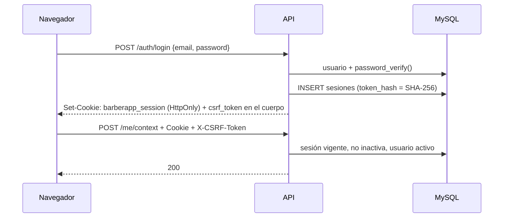

# Autenticación, roles y multiempresa (Fase 2)

Este documento explica cómo entra un usuario a BARBERAPP, cómo se protege cada endpoint y cómo se decide qué puede hacer dentro de cada barbería.

## 1. Resumen

| Tema | Decisión |
|---|---|
| Contraseñas | `password_hash()` (bcrypt) y `password_verify()`. Se re-hashean solas si PHP cambia el algoritmo por defecto. Mínimo 8 caracteres, letras y números, máximo 72 bytes, sin contraseñas comunes ni el propio correo. |
| Web | Cookie de sesión `HttpOnly` + `SameSite=Lax` (+ `Secure` en producción) con un token opaco. En la base solo se guarda su SHA-256. Las peticiones que modifican datos exigen la cabecera `X-CSRF-Token`. |
| App móvil (Capacitor) | Access token firmado HS256 de **15 minutos** + refresh token opaco **rotativo** (cada uno sirve una sola vez, vence a los 30 días). |
| Revocación | Cada access token apunta a una sesión (`sid`). Cerrar sesión, cambiar la contraseña o bloquear al usuario lo invalida al instante. |
| Límite de intentos | Contadores en MySQL (`limites_intentos`), así funciona igual con varios procesos o servidores. Responde **429** con `Retry-After`. |
| Auditoría | Inicios de sesión, fallos, CSRF inválido, tokens falsos, permisos denegados y accesos a otra barbería quedan en `auditoria` con IP, user-agent y request id. |
| Multiempresa | El tenant nunca se toma de un id enviado por el cliente: se resuelve por *slug* (`X-Tenant` o ruta) o por la barbería elegida en la sesión, y siempre se verifica la membresía activa en la base. |

## 2. Endpoints

Base: `/api/v1`. Todas las respuestas usan el sobre `{"ok": true, "data": …}` / `{"ok": false, "error": {"code", "message", "details"}}`.

| Método | Ruta | Acceso | Descripción |
|---|---|---|---|
| POST | `/auth/register` | público | Registro de cliente o propietario (crea su barbería). Inicia sesión. |
| POST | `/auth/login` | público | Inicio de sesión (`canal`: `web` o `movil`). |
| POST | `/auth/logout` | sesión | Cierra la sesión actual; con `{"todas": true}` cierra todas. |
| POST | `/auth/refresh` | refresh token | Rota el refresh token y entrega un access token nuevo (móvil). |
| POST | `/auth/forgot-password` | público | Envía el enlace de recuperación. Responde igual exista o no el correo. |
| POST | `/auth/reset-password` | token de correo | Cambia la contraseña y cierra **todas** las sesiones. |
| POST | `/auth/verify-email` | token de correo | Confirma el correo. |
| POST | `/auth/verify-email/resend` | sesión | Reenvía el correo de verificación. |
| GET | `/auth/csrf` | sesión web | Devuelve el token CSRF de la sesión (tras recargar la página). |
| GET | `/me` | sesión | Perfil, rol de plataforma, sesión y barbería activa con roles y permisos. |
| GET | `/me/memberships` | sesión | Barberías donde trabaja: roles, permisos e invitaciones pendientes. |
| POST | `/me/context` | sesión | Elige la barbería de trabajo de la sesión (`{"tenant": "slug"}` o `null`). |
| POST | `/me/memberships/{id}/aceptar` · `/rechazar` | sesión | Responde una invitación al equipo. |
| GET | `/me/sessions` | sesión | Sesiones abiertas (dispositivo, IP, último uso). |
| DELETE | `/me/sessions/{id}` | sesión | Cierra la sesión de otro dispositivo. |
| POST | `/me/sessions/cerrar-otras` | sesión | Cierra todas las sesiones salvo la actual (Fase 13). |
| PUT | `/me/perfil` | sesión | Rectifica nombres, apellidos y teléfono (Fase 13). |
| POST | `/me/password` | sesión + contraseña actual | Cambia la contraseña y cierra las demás sesiones (Fase 13). |
| POST | `/me/email` | sesión + contraseña | Pide cambiar el correo: enlace al correo nuevo y aviso al anterior (Fase 13). |
| POST | `/auth/confirm-email` | token de correo | Confirma el correo nuevo (`verificar.html?token=…&cambio=1`). |
| POST | `/me/legal/aceptar` | sesión | Acepta la versión vigente de términos y privacidad. |
| POST · GET · POST | `/me/datos/exportar` · `/me/eliminacion` · `/me/eliminar` | sesión + contraseña | Descargar mis datos, qué pasará al eliminar la cuenta y eliminarla. Ver [SEGURIDAD.md](SEGURIDAD.md#9-derechos-de-las-personas-arco-y-eliminación-de-cuenta). |
| GET · POST | `/me/solicitudes-datos` | sesión | Solicitudes de derechos ARCO. |
| GET | `/panel/contexto` | integrante | Barbería, mis roles y permisos en ella. |
| GET | `/panel/personal` | `personal.gestionar` | Equipo de la barbería. |
| POST | `/panel/personal` | `personal.gestionar` + correo verificado | Invita a un administrador o barbero. |
| DELETE | `/panel/personal/{id}` | `personal.gestionar` | Revoca el acceso de un integrante. |

### Ejemplos

**Registro de propietario**

```http
POST /api/v1/auth/register
Content-Type: application/json

{
  "tipo": "propietario",
  "email": "duena@mibarberia.pe",
  "password": "Navaja2026x",
  "nombres": "Rosa",
  "apellidos": "Quispe",
  "telefono": "+51987654321",
  "acepta_terminos": true,
  "canal": "web",
  "barberia": { "nombre_comercial": "Barbería La Navaja", "slug": "la-navaja", "ruc": "20123456789" }
}
```

Respuesta `201` (web): fija la cookie `barberapp_session` y devuelve `usuario`, `barberia` (`estado: "pendiente"` mientras el superadministrador no la apruebe), `sesion` y `csrf_token`. La barbería queda como contexto de la sesión. Con `"tipo": "cliente"` no se envía `barberia`.

**Login móvil y renovación**

```http
POST /api/v1/auth/login
{"email": "cliente1@barberapp.test", "password": "Demo2026!", "canal": "movil", "dispositivo": "Samsung A54"}
```

```json
{
  "usuario": { "id": 8, "email": "cliente1@barberapp.test", "email_verificado": true, "…": "…" },
  "sesion": { "id": 12, "canal": "movil", "expira_en": "2027-01-19T17:07:40Z" },
  "token_type": "Bearer",
  "access_token": "eyJhbGciOiJIUzI1NiIs…",
  "expires_in": 900,
  "refresh_token": "eBcldxxK-nyTvL1N76Xh…",
  "refresh_expira_en": "2026-11-20T17:07:40Z"
}
```

La app envía `Authorization: Bearer <access_token>`. Cuando recibe `401 invalid_token`, llama a `POST /auth/refresh` con `{"refresh_token": "…"}` y guarda **ambos** tokens nuevos. Si recibe `401 invalid_refresh_token`, debe pedir iniciar sesión.

**Errores habituales**

| HTTP | `code` | Cuándo |
|---|---|---|
| 401 | `unauthenticated` | Falta iniciar sesión. |
| 401 | `invalid_credentials` | Correo o contraseña incorrectos (mismo mensaje exista o no el correo). |
| 401 | `invalid_token` / `session_expired` | Access token vencido o falso / sesión web cerrada o inactiva. |
| 401 | `invalid_refresh_token` | Refresh token vencido, inválido o reutilizado. |
| 403 | `csrf_mismatch` | Petición con cookie sin `X-CSRF-Token` válido. |
| 403 | `forbidden` | Falta el permiso. |
| 403 | `email_not_verified` | La acción exige correo verificado. |
| 403 | `account_disabled` | Cuenta bloqueada. |
| 404 | `not_found` | Barbería inexistente **o** sin membresía (no se revela cuál de las dos). |
| 409 | `email_taken` | Correo ya registrado. |
| 422 | `validation_failed` | Datos inválidos; `details.fields` trae los errores por campo. |
| 429 | `too_many_attempts` | Límite de intentos; ver `Retry-After`. |

## 3. Sesiones



- **Web:** vence a los 7 días (`SESSION_LIFETIME_HOURS`) o tras 2 horas sin uso (`SESSION_IDLE_MINUTES`). El token CSRF es un HMAC de la sesión con `APP_KEY`: no se guarda y no cambia mientras dure la sesión. El frontend lo guarda en `sessionStorage` (no es una credencial: sin la cookie no sirve) y, si lo pierde, lo recupera con `GET /auth/csrf`.
- **Login CSRF:** los endpoints públicos solo aceptan `application/json`; un formulario de otro sitio no puede enviar ese tipo sin una verificación CORS previa, que solo pasan los orígenes de `CORS_ALLOWED_ORIGINS`.
- **Móvil:** la sesión vence a los 90 días (`AUTH_MOBILE_SESSION_DAYS`). Si alguien presenta un refresh token ya usado (señal de robo), se revoca la sesión completa y queda en la auditoría como `auth.refresh_reutilizado`.
- **Almacenamiento en la app (Fase 12):** el refresh token debe guardarse en almacenamiento seguro nativo (Keychain en iOS, Keystore/EncryptedSharedPreferences en Android) mediante un plugin de Capacitor; el access token de 15 min en `sessionStorage` de la WebView (cada pantalla es un documento distinto; se borra al cerrar la app). No usar `localStorage` para tokens. Implementado en la Fase 12 con `capacitor-secure-storage-plugin` (ver [APPS_MOVILES.md](APPS_MOVILES.md) y la decisión 094).
- **Rotar `APP_KEY`** invalida todos los access tokens y los tokens CSRF (las sesiones web recuperan el suyo con `GET /auth/csrf`).

## 4. Roles, permisos y contexto de barbería

- Un usuario tiene **una cuenta** y puede tener roles distintos en barberías distintas (`membresias`). Solo las membresías `activo` dan acceso; `invitado` espera a que la persona acepte.
- `GET /me/memberships` lista sus barberías. Si trabaja en una sola, al iniciar sesión queda seleccionada; si trabaja en varias, la elige con `POST /me/context`.
- Para el panel, la barbería se toma de (en orden): parámetro de ruta, cabecera `X-Tenant: slug`, barbería elegida en la sesión. `TenantContextMiddleware(requireMembership: true)` verifica en cada petición que la membresía siga activa: revocar a alguien le quita el acceso al instante.
- `PermissionMiddleware('permiso')` consulta `Gate`:
  - `plataforma.*`: solo el rol de plataforma del usuario (superadministrador).
  - `cliente.*`: cualquier cuenta activa (toda persona puede reservar).
  - El resto: permisos de los roles activos del usuario **en la barbería del contexto**.
- El superadministrador **no** tiene acceso implícito al panel ni a los clientes de una barbería.

| Rol | Permisos (catálogo en `CatalogSeeder`) |
|---|---|
| propietario | negocio, sucursales, personal, barberos, servicios, horarios, bloqueos, políticas, reservas, clientes, reportes |
| administrador | reservas, clientes, servicios, horarios, bloqueos, reportes operativos |
| barbero | ver reservas propias, registrar asistencia, solicitar bloqueos, horarios propios |
| cliente | reservar, gestionar sus reservas, favoritos, perfil |
| superadmin | `plataforma.*` |

**Proteger un endpoint nuevo** (fases siguientes):

```php
$r->group('/panel', function (Router $r) {
    $r->get('/reservas', [ReservaController::class, 'index'], [new PermissionMiddleware('reservas.ver_todas')]);
}, [new AuthMiddleware(), new TenantContextMiddleware(true)]);
```

Dentro del controlador, `$this->tenant($request)['id']` es la barbería ya verificada; los repositorios de datos de la barbería extienden `TenantScopedRepository`.

## 5. Invitar personal

1. El propietario (con correo verificado) llama `POST /panel/personal {"email", "rol": "administrador|barbero", "nombres"}`.
2. Si la persona no tiene cuenta, se crea sin contraseña y recibe un enlace (72 h) para crearla; si ya tiene cuenta, recibe un aviso.
3. La persona acepta en **Mi cuenta** (`POST /me/memberships/{id}/aceptar`). Hasta entonces no entra al panel.

## 6. Límites de intentos

| Ámbito | Límite |
|---|---|
| Login por correo + IP | 5 fallos / 15 min (desde otra IP la cuenta sigue accesible: un atacante no puede bloquear al dueño) |
| Login por IP | 20 fallos / 15 min |
| Registro por IP | 10 / hora |
| Recuperación por correo | 3 / hora |
| Recuperación por IP | 10 / hora |
| Tokens de correo inválidos por IP | 10 / 15 min |
| Reenvío de verificación por usuario | 3 / hora |
| Refresh por IP | 60 / minuto |
| Contraseña incorrecta en acciones sensibles, por usuario (Fase 13) | 5 / 15 min |
| Escrituras por IP, general (Fase 13) | 120 / minuto (`RATE_LIMIT_WRITES`) |

Se configuran en `backend/config/auth.php`. `php bin/console auth:purge` (cron diario) borra contadores, sesiones y tokens vencidos.

## 7. Correo

`MAIL_DRIVER=log` (por defecto) guarda cada correo como `.eml` en `backend/storage/mail/`: se abre con cualquier cliente de correo y contiene los enlaces de verificación y recuperación. En producción, `MAIL_DRIVER=smtp` con `MAIL_HOST`, `MAIL_PORT`, `MAIL_ENCRYPTION=tls|ssl`, `MAIL_USERNAME`, `MAIL_PASSWORD` (cliente SMTP propio, sin dependencias, con verificación del certificado). Un fallo de correo se registra en el log y no rompe el registro.

## 8. Pantallas web

En `frontend/www/pages/auth/`: `login.html`, `registro.html` (cliente o propietario), `olvide.html`, `restablecer.html` (también para invitaciones), `verificar.html` y `cuenta.html` (perfil, verificación, barberías e invitaciones, selección de barbería, sesiones abiertas, cerrar sesión en todos los dispositivos y, desde la Fase 13, editar datos, cambiar correo y contraseña, privacidad y eliminar la cuenta). Los tokens que llegan por correo se quitan de la barra de direcciones apenas se leen.

## 9. Limitaciones conocidas

- La aprobación de barberías pendientes y el bloqueo de usuarios se harán desde el panel de superadministrador (Fase 9); hoy se cambian en la base.
- El registro no crea la suscripción de prueba: se hará con los planes en la Fase 10.
- ~~El cambio de correo y de contraseña desde la cuenta no está incluido~~: desde la Fase 13 se cambian en Mi cuenta.
- Los clientes registrados en mostrador sin cuenta (`clientes.usuario_id = NULL`) no se vinculan al crear la cuenta; desde la Fase 5 se vinculan al reservar o abrir "Mis citas" si el correo está verificado y hay un único registro sin dueño con ese correo (decisión 043).
- Desde la Fase 13, `TRUSTED_PROXIES` define los proxies de confianza: solo de ellos se aceptan `X-Forwarded-For` y `X-Forwarded-Proto`; sin configurar se usa `REMOTE_ADDR`.
