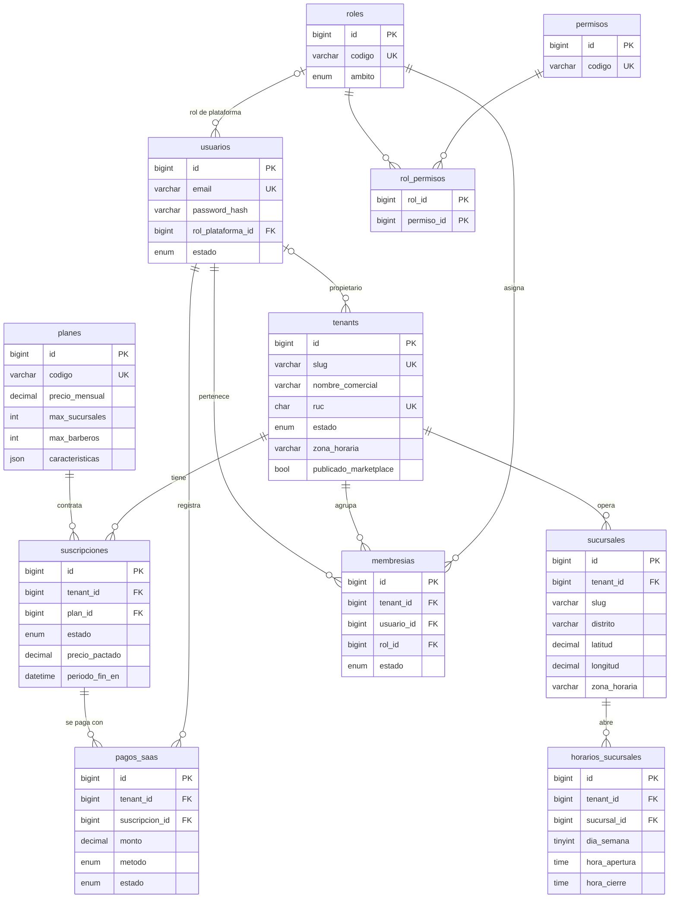
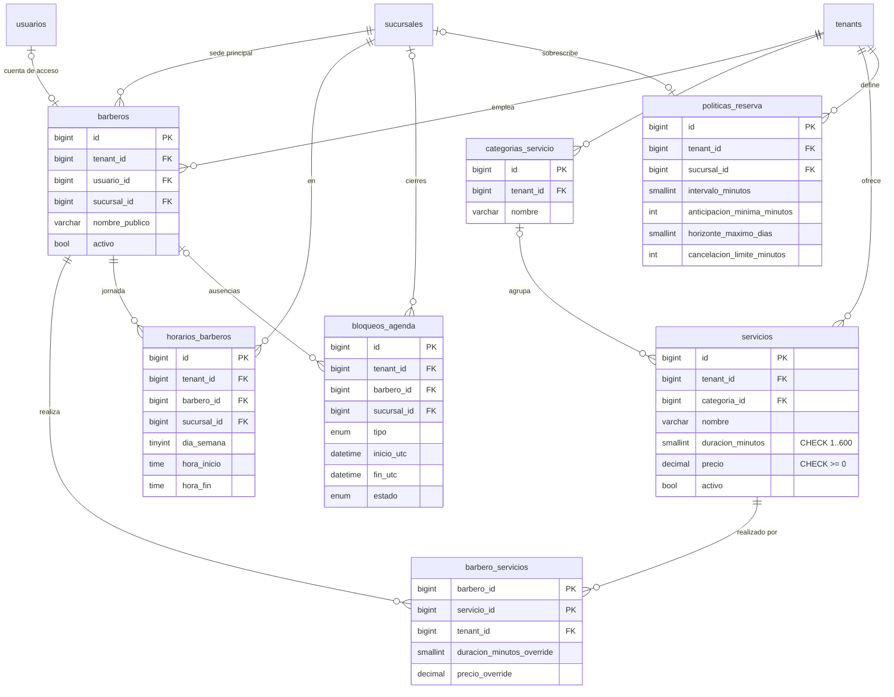
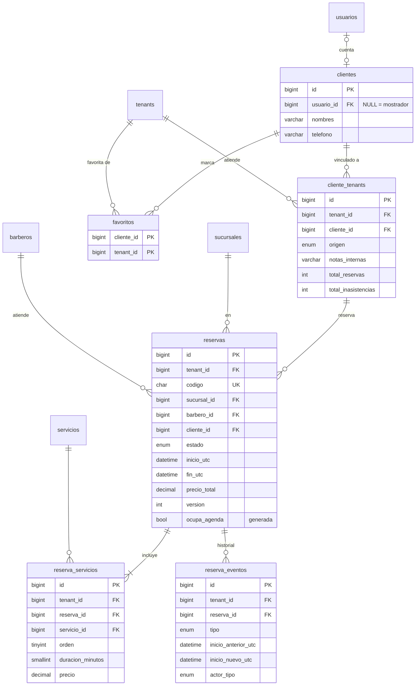
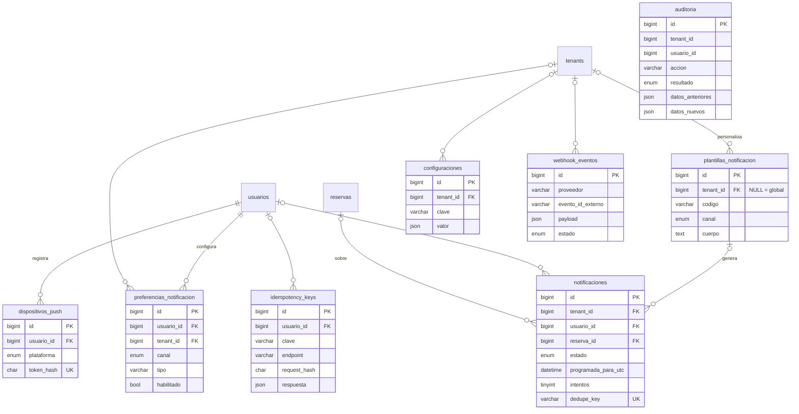

# Modelo entidad-relación

32 tablas en 6 dominios (más la tabla técnica `migraciones`). El detalle de cada columna está en [DICCIONARIO_DATOS.md](DICCIONARIO_DATOS.md), generado desde la base real.

GitHub muestra los diagramas Mermaid directamente. Para verlos en local: VS Code con la extensión *Markdown Preview Mermaid Support*, o pega el bloque en https://mermaid.live.

## Reglas clave del modelo

| Regla | Cómo se garantiza |
|---|---|
| Aislamiento entre barberías | Cada tabla de negocio tiene `tenant_id` y `UNIQUE (tenant_id, id)`. Las relaciones hijas usan **FK compuestas** `(tenant_id, x_id) → padre(tenant_id, id)`, así la base de datos rechaza, por ejemplo, asignar a un barbero un servicio de otra barbería. |
| El cliente reserva solo donde está vinculado | `reservas (tenant_id, cliente_id) → cliente_tenants (tenant_id, cliente_id)` |
| Una persona, varios roles | `usuarios` es global; `membresias (usuario, tenant, rol)` permite ser barbero en una barbería y administrador en otra. |
| Superadmin sin acceso implícito a datos de barberías | El rol de plataforma vive en `usuarios.rol_plataforma_id`, no en `membresias`; sus permisos son solo `plataforma.*`. |
| Una suscripción vigente por barbería | Columna generada `tenant_vigente` con índice único. |
| Duración > 0, precio ≥ 0, rangos válidos | Restricciones `CHECK` en servicios, reservas, horarios, bloqueos, pagos. |
| Doble reserva | `SELECT … FOR UPDATE` sobre la fila de `barberos` + verificación de solapamiento en la transacción (Fase 5), apoyada por el índice `idx_reservas_agenda (barbero_id, ocupa_agenda, inicio_utc, fin_utc)`. |
| Reintentos de red | `idempotency_keys` única por (usuario, método, endpoint, clave). |
| Recordatorios sin duplicados | `notificaciones.dedupe_key` única. |
| Fechas | Eventos en UTC (`*_utc`, `*_en`); horarios semanales en hora local de la sucursal (`TIME`) junto con su `zona_horaria`. |
| Importes | `DECIMAL(10,2)` + `moneda` ISO 4217 (PEN). El precio de la reserva es **previsto**, no ingreso cobrado. |

## Núcleo SaaS

## Gestión de barberías

## Clientes y reservas

## Notificaciones y sistema

