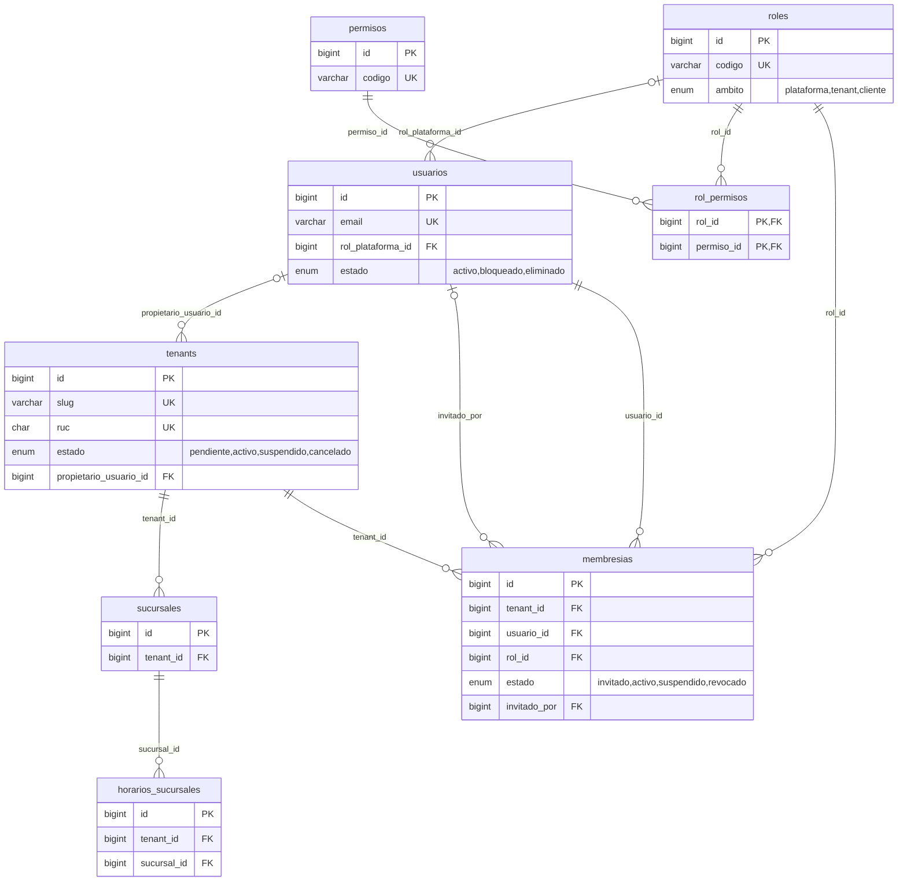
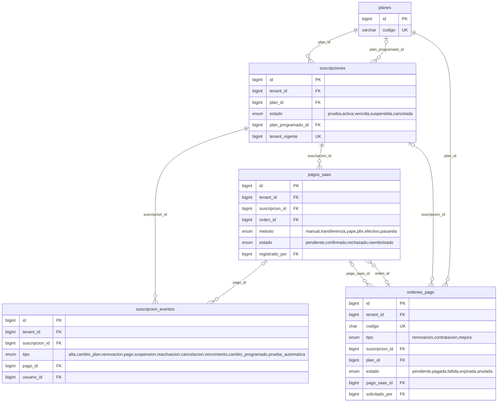
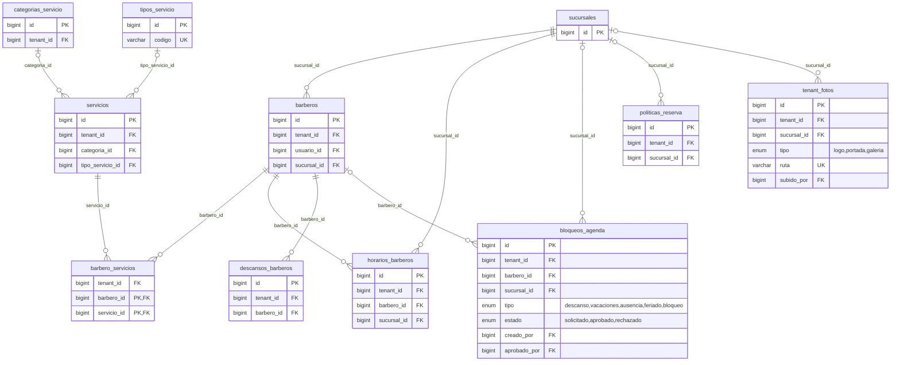
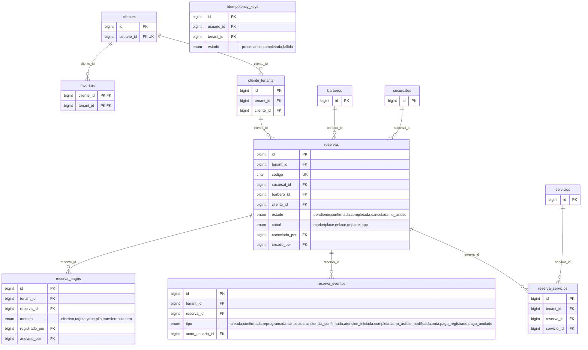
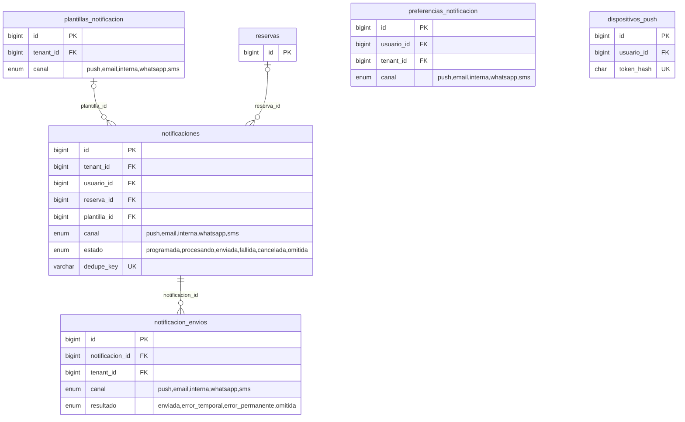
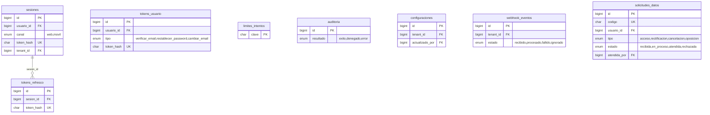

# Modelo entidad-relación

<!-- generado:resumen -->
44 tablas en 6 dominios (más la tabla técnica `migraciones`).
<!-- /generado:resumen -->
El detalle de cada columna (tipo, nulos, valores por defecto, comentarios y claves foráneas) está en [DICCIONARIO_DATOS.md](DICCIONARIO_DATOS.md). Tanto ese archivo como los diagramas de abajo se **generan desde la base migrada** con `php bin/console docs:generar`; la prueba `DocumentationTest` falla si una migración cambia el modelo y no se regeneran.

GitHub muestra los diagramas Mermaid directamente. En local: VS Code con la extensión *Markdown Preview Mermaid Support*, o pega el bloque en https://mermaid.live. Versiones SVG para imprimir en [`docs/diagramas/`](diagramas/) (se regeneran con `node frontend/scripts/diagramas-svg.mjs`).

Cómo leer los diagramas: cada línea va de la tabla padre a la hija y lleva el nombre de la columna que las une. `||--o{` = una a muchas (columna obligatoria), `|o--o{` = la hija puede no tener padre (columna que admite NULL), `--o|` = una a una (índice único). En las claves foráneas compuestas `(tenant_id, x_id)` se muestra solo `x_id`. En cada tabla aparecen sus claves (PK, FK, UK) y sus columnas de estado o tipo con los valores posibles. `tenants` y `usuarios` se dibujan solo en el núcleo, aunque casi todas las tablas las referencian.

## Reglas clave del modelo

| Regla | Cómo se garantiza |
|---|---|
| Aislamiento entre barberías | Cada tabla de negocio tiene `tenant_id` y `UNIQUE (tenant_id, id)`. Las relaciones hijas usan **FK compuestas** `(tenant_id, x_id) → padre(tenant_id, id)`, así la base de datos rechaza, por ejemplo, asignar a un barbero un servicio de otra barbería. |
| El cliente reserva solo donde está vinculado | `reservas (tenant_id, cliente_id) → cliente_tenants (tenant_id, cliente_id)` |
| Una persona, varios roles | `usuarios` es global; `membresias (usuario, tenant, rol)` permite ser barbero en una barbería y administrador en otra. |
| Superadmin sin acceso implícito a datos de barberías | El rol de plataforma vive en `usuarios.rol_plataforma_id`, no en `membresias`; sus permisos son solo `plataforma.*`. |
| Una suscripción vigente por barbería | Columna generada `tenant_vigente` con índice único. |
| Duración > 0, precio ≥ 0, rangos válidos | Restricciones `CHECK` en servicios, reservas, horarios, bloqueos, pagos. |
| Doble reserva | `SELECT … FOR UPDATE` sobre la fila de `barberos` + verificación de solapamiento en la transacción (Fase 5), apoyada por el índice `idx_reservas_agenda (barbero_id, ocupa_agenda, inicio_utc, fin_utc)`. |
| Reintentos de red | `idempotency_keys` única por (usuario, método, endpoint, clave). |
| Recordatorios sin duplicados | `notificaciones.dedupe_key` única. |
| Fechas | Eventos en UTC (`*_utc`, `*_en`); horarios semanales en hora local de la sucursal (`TIME`) junto con su `zona_horaria`. |
| Importes | `DECIMAL(10,2)` + `moneda` ISO 4217 (PEN). El precio de la reserva es **previsto**; lo cobrado está en `reserva_pagos` (Fase 6). |
| Cobros de la plataforma | `ordenes_pago` (pago en línea, Fase 10) y `pagos_saas` (manual o confirmado por webhook); `webhook_eventos` evita aplicar dos veces el mismo aviso de la pasarela. |
| Historial auditable | `reserva_eventos` (cada cambio de una cita), `suscripcion_eventos` (Fase 9) y `auditoria` (solo INSERT, sin FK para sobrevivir a borrados). |
| Datos personales | `solicitudes_datos` registra los pedidos ARCO con su plazo; eliminar una cuenta anonimiza `usuarios` y `clientes` sin romper reservas ni cobros (Fase 13). |

## Migraciones

| Migración | Fase | Qué agrega |
|---|---|---|
| `0001_nucleo_saas.sql` | 1 | Barberías, sucursales, cuentas, roles y permisos, planes, suscripciones y pagos |
| `0002_gestion_barberias.sql` | 1 | Barberos, servicios, horarios, bloqueos y reglas de reserva |
| `0003_clientes.sql` | 1 | Clientes, vínculo con cada barbería y favoritos |
| `0004_reservas.sql` | 1 | Reservas, sus servicios y su historial de eventos |
| `0005_notificaciones.sql` | 1 | Avisos, plantillas, preferencias y dispositivos push |
| `0006_sistema.sql` | 1 | Auditoría, configuraciones, webhooks e idempotencia |
| `0007_autenticacion.sql` | 2 | Sesiones, refresh tokens, tokens de un uso y límites de intentos |
| `0008_marketplace.sql` | 3 | Tipos de servicio, fotos y redes de la barbería |
| `0009_agenda_barberos.sql` | 4 | Categorías, descansos, vigencias y bloqueos por sucursal |
| `0010_motor_reservas.sql` | 5 | Columnas y restricciones del motor de reservas y la política |
| `0011_panel_barberia.sql` | 6 | Cobros de las citas, notas internas y datos de mostrador |
| `0012_panel_barbero.sql` | 7 | Solicitudes de ausencia con aprobación |
| `0013_recordatorios.sql` | 8 | Cola de avisos con reintentos y registro de envíos |
| `0014_superadmin_saas.sql` | 9 | Datos de demostración, bloqueo de cuentas, eventos de suscripción, rol operador |
| `0015_planes_monetizacion.sql` | 10 | Órdenes de pago en línea, cambios de plan programados, restricción por falta de pago |
| `0016_seguridad_datos.sql` | 13 | Solicitudes de derechos ARCO, versiones de textos legales, cambio de correo |

## Diagramas por dominio

<!-- generado:diagramas -->
### Núcleo SaaS: barberías, sucursales, cuentas y roles

### Planes, suscripciones y cobros de la plataforma

### Catálogo y agenda de la barbería

### Clientes y reservas

### Avisos y notificaciones

### Seguridad, sesiones y sistema

<!-- /generado:diagramas -->
