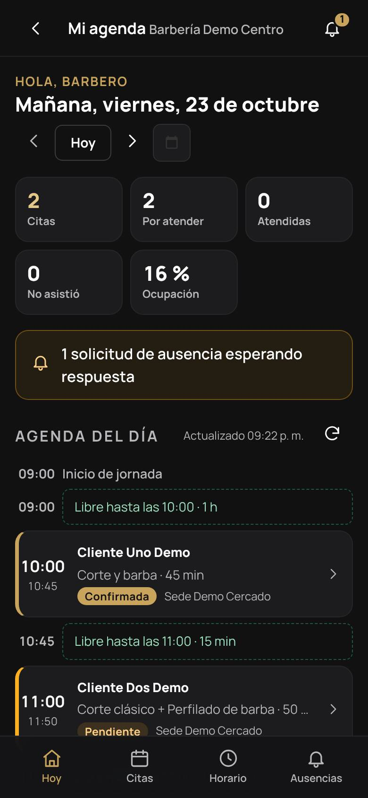
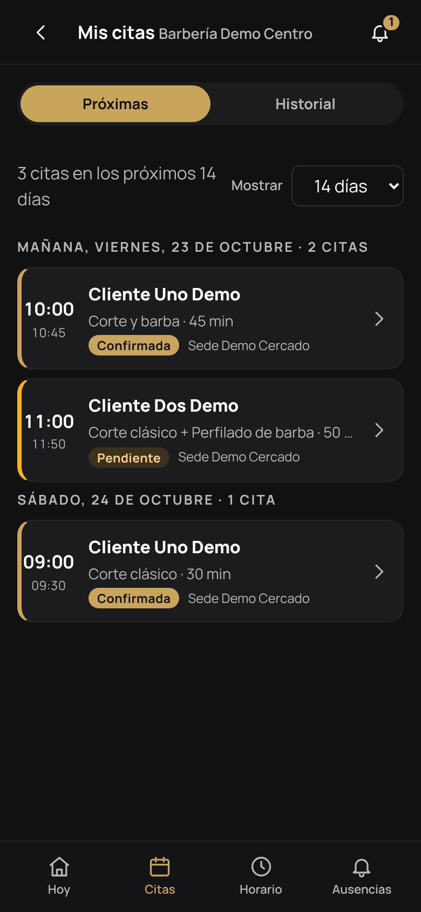
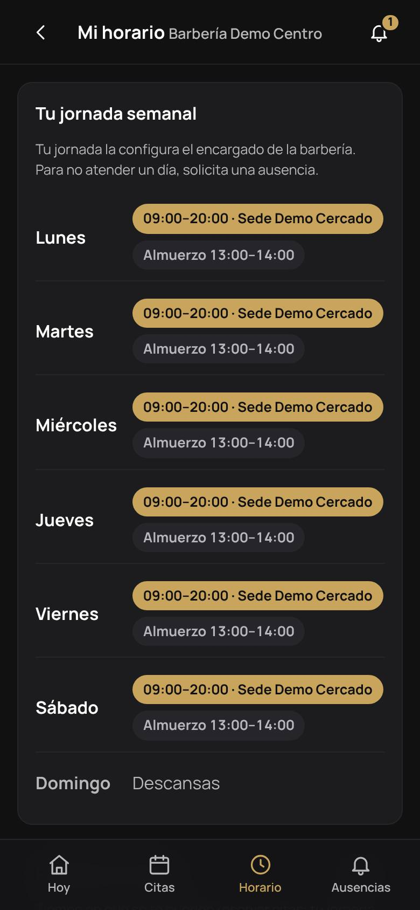
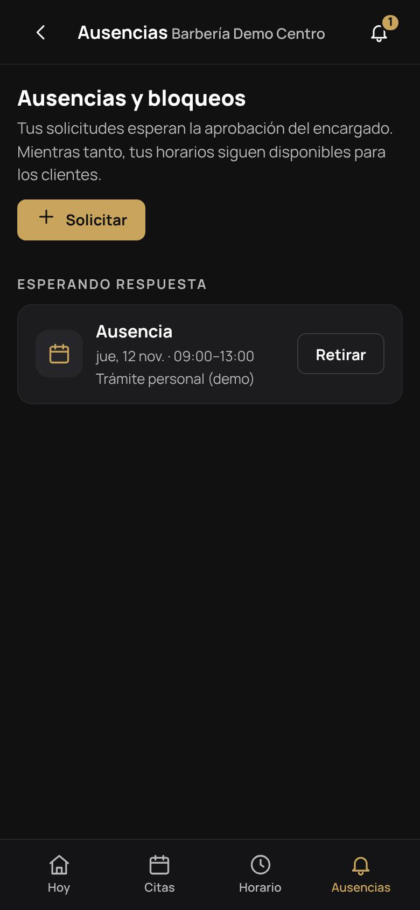

# Manual del barbero

Tu agenda en el teléfono: qué citas tienes, quién viene ahora, cómo marcar a un cliente como atendido y cómo pedir días libres. El panel del barbero está pensado para usarse con una mano, entre cliente y cliente.

> Las capturas son de la instalación de demostración (`php bin/console db:seed --demo`): *Barbero Uno Demo* de *Barbería Demo Centro*, clientes "Demo" y fechas del día en que se tomaron. No son datos reales. Se regeneran con `node scripts/capturas-manuales.mjs` desde `frontend/`.

## Antes de empezar

1. Crea tu cuenta en BARBERAPP (**Crear cuenta → Quiero reservar** sirve) y **verifica tu correo**.
2. Pide al encargado de la barbería que te invite como barbero.
3. Acepta la invitación en **Mi cuenta → Mis barberías**.
4. El encargado vincula tu cuenta a tu ficha de barbero. Desde ese momento, en **Mi cuenta** aparece **Mi agenda**.

Si al entrar ves *Tu cuenta no tiene ficha de barbero*, falta el paso 4.

Te recomendamos [instalar la app](CLIENTE.md#1-instalar-la-app) para recibir notificaciones push de tus citas nuevas, cambios y cancelaciones.

La barra inferior tiene cuatro secciones: **Hoy**, **Citas**, **Horario** y **Ausencias**.

## 1. Hoy

**Hoy** te muestra:

- La cita **en atención** o la **siguiente**, con cuánto falta y sus botones grandes.
- Indicadores del día: citas, por atender, atendidas, no asistió y tu ocupación.
- Avisos, como solicitudes de ausencia que esperan respuesta.
- **Agenda del día:** tu jornada con sus citas, los huecos libres, los descansos (por ejemplo, el almuerzo), las ausencias y una línea roja con la hora actual.

Con las flechas o el calendario puedes ver otros días. La agenda se actualiza sola cada minuto mientras la tienes abierta.

 

## 2. Atender una cita

Toca una cita para abrir su ficha. Verás:

- Los servicios con la hora de cada uno, la duración y el precio de lista.
- El nombre y el teléfono del cliente, con botones **Llamar** y **WhatsApp**, y la nota que dejó al reservar.
- Las **notas internas** de la cita, que puedes editar. Solo las ve el personal.
- Las **visitas anteriores de ese cliente contigo** y el historial de cambios de la cita.

Los botones aparecen solo cuando corresponden:

| Botón | Cuándo |
|---|---|
| **Confirmar** | La cita está pendiente. |
| **Iniciar atención** | Desde 30 minutos antes de la hora. |
| **Marcar atendido** | Desde ese mismo momento. |
| **No asistió** | Desde la hora de inicio, si no se inició la atención. |

Durante 7 días puedes corregir una cita de *atendida* a *no asistió* o al revés, salvo que ya tenga cobros. Cancelar, reprogramar y cobrar lo hacen el encargado o el administrador desde el panel de la barbería.

## 3. Citas

- **Próximas:** tus citas de los próximos 7, 14 o 31 días, agrupadas por día y con su estado.
- **Historial:** tus citas pasadas (de 7 a 365 días), con atendidas, inasistencias, canceladas y tu tasa de inasistencia. Puedes filtrar por estado.

Si trabajas en varias sedes de la misma barbería, verás las citas de todas.

 

## 4. Horario

**Horario** muestra:

- Tu **jornada semanal**: tramos de cada día, sede y descansos.
- El **tiempo que puedes recibir reservas** en los próximos 14 días, en barras por día. Así ves de un vistazo si un feriado o una ausencia te quita horas.
- Tus **ausencias próximas**.

Normalmente la jornada la configura el encargado. Si la barbería te permite editarla, verás el botón para cambiar tus tramos y descansos. Los cambios nunca pueden salir del horario de atención de la sede.

 

## 5. Ausencias

Para no atender un día o unas horas, toca **Solicitar**:

1. Elige el tipo: **vacaciones**, **ausencia**, **descanso** o **bloqueo**. Los feriados los define la barbería.
2. Marca **día completo** o un rango de horas, y la sede (o todas tus sedes).
3. Escribe el motivo. Es obligatorio cuando la barbería revisa las solicitudes.

Si la barbería **exige aprobación** (lo habitual), la solicitud queda *Esperando respuesta* y **mientras tanto tus horarios siguen disponibles** para los clientes. Cuando el encargado responda verás si se aprobó o se rechazó, con su comentario. Puedes **retirar** una solicitud mientras siga pendiente.

Si la barbería no exige aprobación, la ausencia se aplica al instante. Si ya hay citas en ese rango, la app te lo indica para que lo coordines con el encargado.

En esta pantalla también ves los feriados de la barbería.

 

## 6. Qué ves y qué no

| Ves | No ves |
|---|---|
| Tus citas, en todas tus sedes | Las citas de otros barberos |
| Nombre, teléfono y nota del cliente | El correo del cliente |
| Servicios con duración y precio de lista | Cobros, saldos e ingresos |
| Tus visitas anteriores con ese cliente | Sus visitas con otros barberos |
| Tu jornada, descansos, ausencias y los feriados | Reportes, clientes, equipo y configuración de la barbería |

Si además administras la barbería (por ejemplo, eres el propietario y también cortas), en tu agenda aparece el botón **Panel** para pasar al [panel de la barbería](PROPIETARIO.md).

## 7. Preguntas frecuentes

| Pregunta | Respuesta |
|---|---|
| No me llegan notificaciones | Instala la app y permite las notificaciones. En **Mi cuenta → Avisos** revisa que estén encendidas y que tu teléfono figure en la lista. |
| No puedo marcar *atendido* | El botón aparece desde 30 minutos antes de la cita. Si ya pasaron más de 7 días, pide al encargado que la corrija. |
| Pedí vacaciones y siguen entrando reservas | Tu solicitud espera aprobación. Hasta que se apruebe, el horario sigue abierto. |
| Quiero cambiar mi horario | Pídelo al encargado o, si la barbería lo permite, edítalo en **Horario**. |
| Veo una cita que no es mía | No es posible: solo se muestran las tuyas. Si te asignaron una por error, avisa al encargado para que la reprograme. |
