# Manual del cliente

Cómo buscar una barbería, reservar, cambiar o cancelar una cita y cuidar tus datos en BARBERAPP. Sirve igual para la web, la app instalada desde el navegador (PWA) y las apps de Android e iOS: las pantallas son las mismas.

> Las capturas son de la instalación de demostración (`php bin/console db:seed --demo`): barberías "Demo …", cuentas `@barberapp.test` y fechas del día en que se tomaron. No son datos reales. Se regeneran con `node scripts/capturas-manuales.mjs` desde `frontend/`.

## Contenido

1. [Instalar la app](#1-instalar-la-app)
2. [Crear tu cuenta](#2-crear-tu-cuenta)
3. [Buscar una barbería](#3-buscar-una-barbería)
4. [Ver una barbería](#4-ver-una-barbería)
5. [Reservar una cita](#5-reservar-una-cita)
6. [Tu comprobante](#6-tu-comprobante)
7. [Mis citas: reprogramar, cancelar y confirmar](#7-mis-citas-reprogramar-cancelar-y-confirmar)
8. [Avisos y recordatorios](#8-avisos-y-recordatorios)
9. [Favoritas](#9-favoritas)
10. [Mi cuenta, privacidad y eliminar la cuenta](#10-mi-cuenta-privacidad-y-eliminar-la-cuenta)
11. [Preguntas frecuentes](#11-preguntas-frecuentes)

La barra inferior tiene cinco accesos: **Inicio**, **Explorar**, **Favoritas**, **Citas** y **Cuenta**. La campana de arriba abre tus avisos.

## 1. Instalar la app

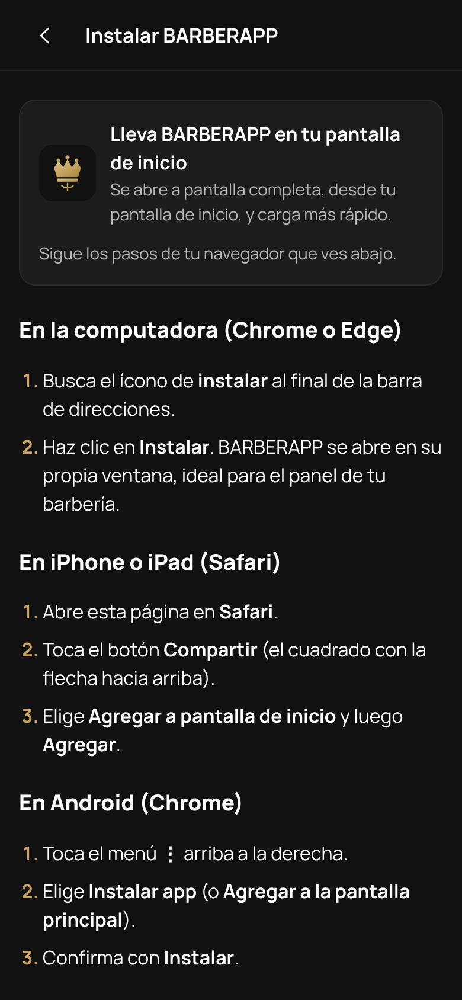

Puedes usar BARBERAPP en el navegador sin instalar nada. Si quieres tenerla como app, abre **Cuenta → Instalar BARBERAPP en este dispositivo** (o la página *Instalar*), que explica los pasos para cada equipo:

- **iPhone o iPad (Safari):** botón *Compartir* → *Agregar a pantalla de inicio* → *Agregar*.
- **Android (Chrome):** menú ⋮ → *Instalar app* → *Instalar*.
- **Computadora (Chrome o Edge):** ícono de instalar al final de la barra de direcciones.

Si la barbería te indicó la app de Google Play o App Store, también puedes instalarla desde allí: es la misma aplicación y, además, recibe notificaciones push.

Las pantallas que ya abriste se pueden ver sin conexión. Reservar, cancelar o reprogramar siempre necesita internet, porque la cita solo queda confirmada cuando la barbería la recibe.

 

## 2. Crear tu cuenta

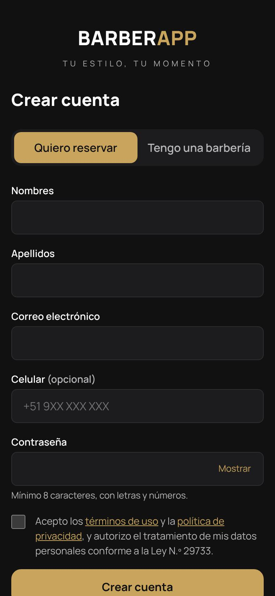

Puedes mirar barberías sin cuenta. Para reservar necesitas una:

1. Toca **Cuenta → Crear cuenta** y deja marcado **Quiero reservar**.
2. Escribe nombres, apellidos, correo y contraseña. El celular es opcional, pero ayuda a la barbería a ubicarte.
3. La contraseña debe tener **al menos 8 caracteres, con letras y números**.
4. Acepta los términos de uso y la política de privacidad (Ley N.° 29733) y toca **Crear cuenta**.
5. Te llega un correo para **verificar tu dirección**. Abre el enlace: hasta que lo hagas puedes navegar, pero **no reservar**. Si no llegó, en *Mi cuenta* puedes pedir que se reenvíe.

¿Olvidaste tu contraseña? En **Iniciar sesión → ¿Olvidaste tu contraseña?** escribe tu correo y sigue el enlace que te llega. Cambiarla cierra tu sesión en todos tus dispositivos.

 

## 3. Buscar una barbería

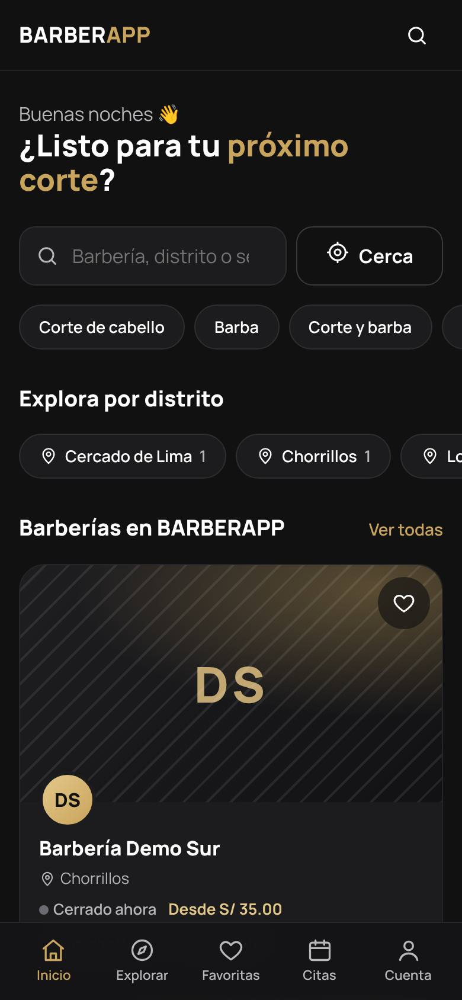

**Inicio** reúne:

- El **buscador** (nombre de la barbería, distrito o servicio).
- **Cerca**: pide permiso para usar tu ubicación y ordena por distancia. Si no lo das, todo lo demás funciona igual.
- Accesos por tipo de servicio (*Corte de cabello*, *Barba*, *Corte y barba*…).
- **Explora por distrito**, con cuántas barberías hay en cada uno.
- Tus favoritas (con sesión) y las barberías de BARBERAPP.

**Explorar** muestra la lista completa con filtros por distrito, tipo de servicio y precio. Solo aparecen barberías activas y con al menos una sede, un servicio y un barbero disponibles.

Si una barbería te pasó su **enlace directo** (`…/b/nombre-de-la-barberia`) o su **código QR**, ábrelo: te lleva a su perfil aunque no aparezca en la búsqueda.

 

## 4. Ver una barbería

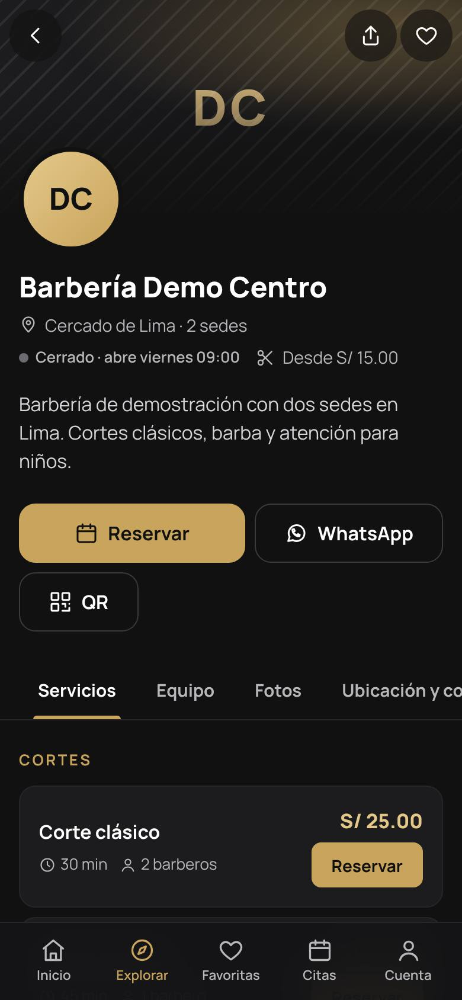

El perfil muestra el distrito, cuántas sedes tiene, si está **abierta o cerrada ahora** (según su horario real) y desde qué precio atiende. Debajo hay cuatro pestañas:

- **Servicios**, agrupados por categoría, con duración, precio y cuántos barberos lo hacen. Cada uno tiene su botón **Reservar**.
- **Equipo**: los barberos y su especialidad.
- **Fotos** del local y de los trabajos.
- **Ubicación y contacto**: dirección de cada sede, horario, mapa y redes.

Arriba puedes **compartir** el perfil o guardarlo como **favorita** (corazón). Los botones **WhatsApp** y **QR** abren el chat con la barbería y su código para compartir.

 

## 5. Reservar una cita

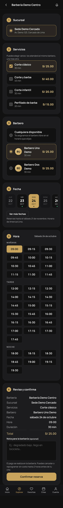

Toca **Reservar** en el perfil o en un servicio. La reserva tiene seis pasos en una sola pantalla:

1. **Sucursal.** Si la barbería tiene una sola, ya viene elegida.
2. **Servicios.** Puedes elegir varios: los atenderá el mismo barbero, uno tras otro, y la duración se suma.
3. **Barbero.** Elige uno o **Cualquiera disponible**: el sistema asigna al barbero libre que tenga menos citas ese día. Si el precio cambia según el barbero, lo verás aquí.
4. **Fecha.** Los días con un punto tienen horarios libres. **Ver más fechas** muestra más días, hasta el límite que fijó la barbería (por ejemplo, *Reservas hasta el sábado 21 de noviembre*).
5. **Hora**, agrupada en mañana, tarde y noche. Solo aparecen horas en las que el barbero está libre durante todo el servicio. Las horas son las **de la barbería** (por ejemplo, Lima), aunque tu teléfono esté en otra zona.
6. **Revisa y confirma.** Verás el resumen con el total y la política de cancelación. Puedes dejar una nota para la barbería (hasta 500 caracteres). Toca **Confirmar reserva**.

Si alguien tomó esa hora un segundo antes que tú, la app te avisa y te muestra otras horas libres: **nunca se crean dos citas a la misma hora con el mismo barbero**. Si la conexión falla mientras confirmas, vuelve a tocar el botón: la app reintenta la misma reserva sin duplicarla.

Si empezaste a reservar sin haber iniciado sesión, tu elección se guarda unas horas y se retoma después de entrar.

**El pago se hace en la barbería**, no en la app.

 

## 6. Tu comprobante

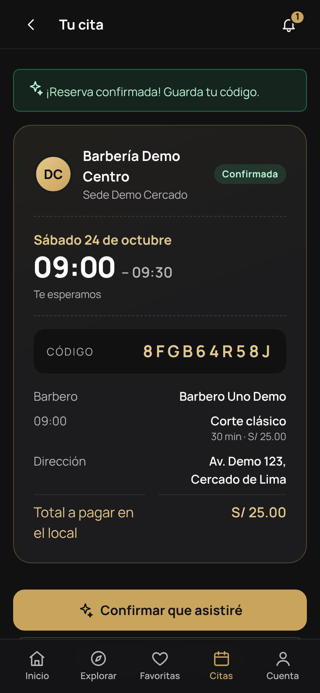

Al confirmar verás **Tu cita** con:

- El **estado**: *Confirmada* o *Pendiente*, si la barbería revisa cada reserva antes de aceptarla.
- Día, hora de inicio y de fin.
- Un **código** de 10 caracteres. Guárdalo: es tu referencia ante la barbería.
- Barbero, servicios con su hora, dirección y **total a pagar en el local**.

Más abajo están los botones **Confirmar que asistiré**, **Agregar a mi calendario**, **Cómo llegar** y **Escribir a la barbería**, además de **Reprogramar**, **Cancelar** y el historial de cambios de la cita.

 

## 7. Mis citas: reprogramar, cancelar y confirmar

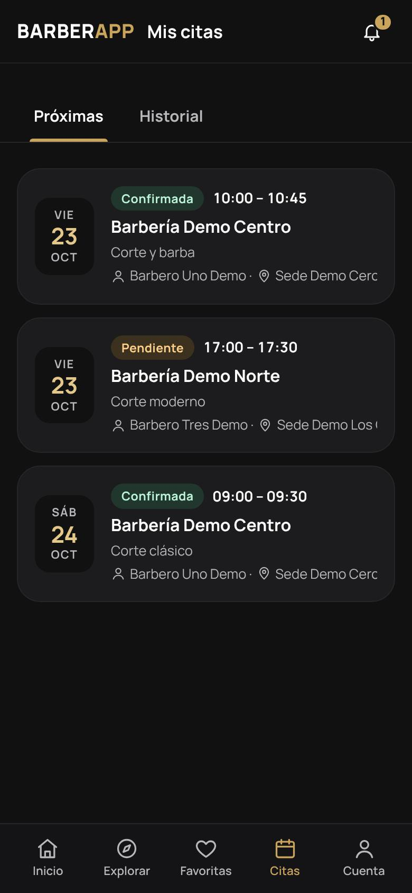

**Citas** tiene dos pestañas:

- **Próximas**: citas de todas las barberías, ordenadas por fecha.
- **Historial**: las atendidas, canceladas y aquellas a las que no asististe.

Toca una cita para abrir su comprobante. Desde ahí puedes:

- **Reprogramar.** Elige otro día y hora (y otro barbero, si la cita se asignó como *Cualquiera disponible*). Tu horario actual se conserva hasta que el nuevo queda confirmado. Cada barbería fija cuántas veces se puede reprogramar una cita (2 por defecto).
- **Cancelar.** Puedes escribir un motivo (lo verá la barbería). El horario queda libre para otra persona al instante.
- **Confirmar que asistiré.** Avisa a la barbería que vas. Si no confirmas, la cita **no** se cancela.

 

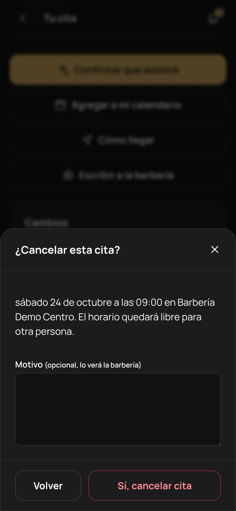

**Plazos.** Cada barbería decide hasta cuándo se puede cancelar o reprogramar en línea (por defecto, **hasta 2 horas antes**). Pasado ese plazo, la app lo explica y te ofrece escribir a la barbería. Una cita que ya empezó no se puede cancelar desde la app.

**Límites.** Una barbería puede limitar cuántas citas activas tienes con ella al mismo tiempo. Además, la app no te deja reservar dos citas que se crucen, aunque sean en barberías distintas.

 

## 8. Avisos y recordatorios

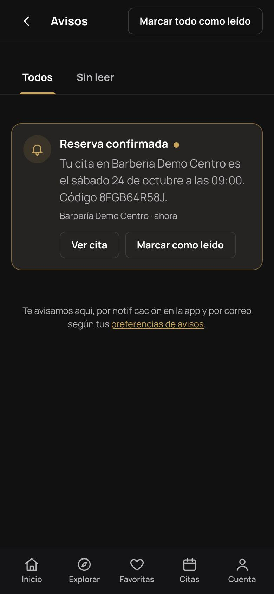

La **campana** guarda todos tus avisos:

- La confirmación de la reserva.
- Los **recordatorios** antes de la cita (por defecto 24 horas y 2 horas antes; cada barbería los ajusta).
- Los cambios o cancelaciones que haga la barbería, con su motivo.

También pueden llegarte por **notificación push** (app instalada) y por **correo** (solo a correos verificados). Lo que tú mismo haces (cancelar o reprogramar) no te genera aviso, porque ya lo viste en pantalla.

Si el recordatorio trae **Confirmar asistencia**, tócalo para avisar que vas. En **Cuenta → Avisos** eliges qué recibir por push y por correo. Los avisos de la bandeja siempre quedan guardados.

 

## 9. Favoritas

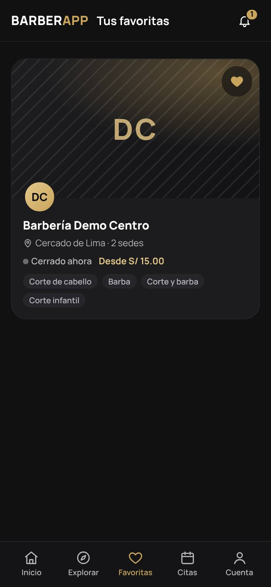

Toca el corazón en una barbería para guardarla. **Favoritas** las reúne para que reserves en dos toques. Necesitas haber iniciado sesión: si no lo hiciste, la app te lo pide y vuelve a la misma pantalla.

 

## 10. Mi cuenta, privacidad y eliminar la cuenta

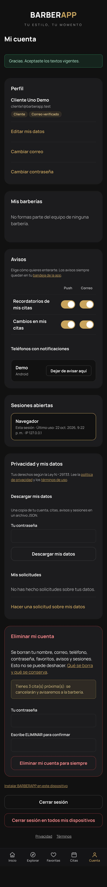

**Cuenta** reúne todo lo tuyo:

- **Perfil:** **Editar mis datos** (nombres, apellidos, teléfono), **Cambiar correo** (se confirma desde el correo nuevo y se avisa al anterior) y **Cambiar contraseña** (cierra tus otras sesiones).
- **Mis barberías:** si trabajas en una barbería, aquí aparecen tu rol, el acceso a su panel y las invitaciones pendientes.
- **Avisos:** interruptores de push y correo por tipo de aviso, y los teléfonos registrados para push, con la opción **Dejar de avisar aquí**.
- **Sesiones abiertas:** dónde está abierta tu cuenta. Puedes cerrar cualquiera o **Cerrar sesión en todos mis dispositivos**.
- **Privacidad y mis datos** (Ley N.° 29733):
  - **Descargar mis datos:** con tu contraseña obtienes un archivo con tu cuenta, citas, favoritas, avisos y sesiones.
  - **Hacer una solicitud sobre mis datos:** acceso, rectificación, cancelación u oposición (derechos ARCO). Ves su estado y el plazo de respuesta.
- **Eliminar mi cuenta:** pide tu contraseña y escribir `ELIMINAR`. Se borran tu nombre, correo, teléfono, contraseña, favoritas, avisos y sesiones, y tus citas próximas se cancelan con aviso a la barbería. **No se puede deshacer.** El enlace *Qué se borra y qué se conserva* lo explica en detalle: por ejemplo, las barberías conservan el registro anónimo de las citas pasadas y sus cobros (sin tu nombre ni contacto) por obligaciones contables.

 

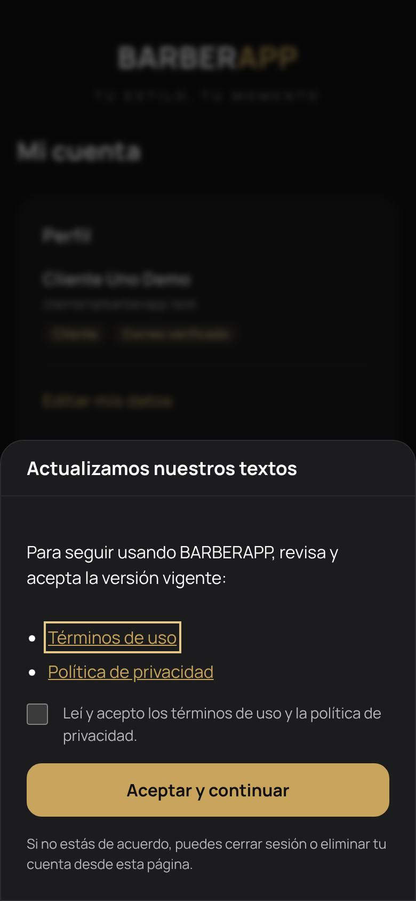

Cuando BARBERAPP actualiza sus términos o su política de privacidad, la app te pide leerlos y aceptarlos antes de seguir. Si no estás de acuerdo, puedes cerrar sesión o eliminar tu cuenta desde esa misma pantalla.

 

## 11. Preguntas frecuentes

| Pregunta | Respuesta |
|---|---|
| No puedo reservar: me pide verificar el correo | Abre el enlace del correo de bienvenida. En *Mi cuenta* puedes pedir que se reenvíe; revisa también la carpeta de spam. |
| No veo horas libres | El barbero puede estar completo, de vacaciones o fuera de su jornada ese día. Prueba con otro día, con *Cualquiera disponible* o con otra sede. |
| Una barbería no aparece en la búsqueda | Puede haber decidido no publicarse o estar suspendida. Si tienes su enlace directo o su QR, sí puedes abrirla. |
| ¿Puedo pagar en la app? | No. El pago se hace en la barbería; la app muestra el total como referencia. |
| La hora que veo es distinta a la de mi teléfono | Las horas siempre están en la zona horaria de la barbería. |
| Ya no puedo cancelar | Pasó el plazo que fijó la barbería. Escríbele desde el comprobante. |
| ¿Me cancelan si no confirmo? | No. Confirmar solo ayuda a la barbería a organizarse. |
| Cambié de teléfono | Inicia sesión en el nuevo. En *Mi cuenta → Sesiones abiertas* puedes cerrar la sesión del anterior. |
