# Manual del propietario de la barbería

Cómo registrar tu barbería, dejarla lista para recibir reservas y usar el panel todos los días: agenda, cobros, clientes, equipo, reportes y suscripción. El administrador de la barbería usa el mismo panel con menos permisos (ver [Roles del equipo](#11-roles-del-equipo)).

El panel funciona en la computadora, en la tablet y en el teléfono. Se abre desde **Mi cuenta → Abrir panel**, o directamente en `pages/panel/inicio.html`.

> Las capturas son de la instalación de demostración (`php bin/console db:seed --demo`): *Barbería Demo Centro*, barberos y clientes "Demo" y fechas del día en que se tomaron. No son datos reales. Se regeneran con `node scripts/capturas-manuales.mjs` desde `frontend/`.

## Contenido

1. [Registrar tu barbería](#1-registrar-tu-barbería)
2. [Lista para recibir reservas: primeros pasos](#2-lista-para-recibir-reservas-primeros-pasos)
3. [Inicio: el resumen del día](#3-inicio-el-resumen-del-día)
4. [Agenda](#4-agenda)
5. [Cobros](#5-cobros)
6. [Clientes](#6-clientes)
7. [Servicios, barberos y sucursales](#7-servicios-barberos-y-sucursales)
8. [Ausencias y vacaciones](#8-ausencias-y-vacaciones)
9. [Avisos a tus clientes](#9-avisos-a-tus-clientes)
10. [Reportes](#10-reportes)
11. [Roles del equipo](#11-roles-del-equipo)
12. [Perfil público, enlace y QR](#12-perfil-público-enlace-y-qr)
13. [Configuración y reglas de reserva](#13-configuración-y-reglas-de-reserva)
14. [Suscripción y pagos](#14-suscripción-y-pagos)
15. [Preguntas frecuentes](#15-preguntas-frecuentes)

## 1. Registrar tu barbería

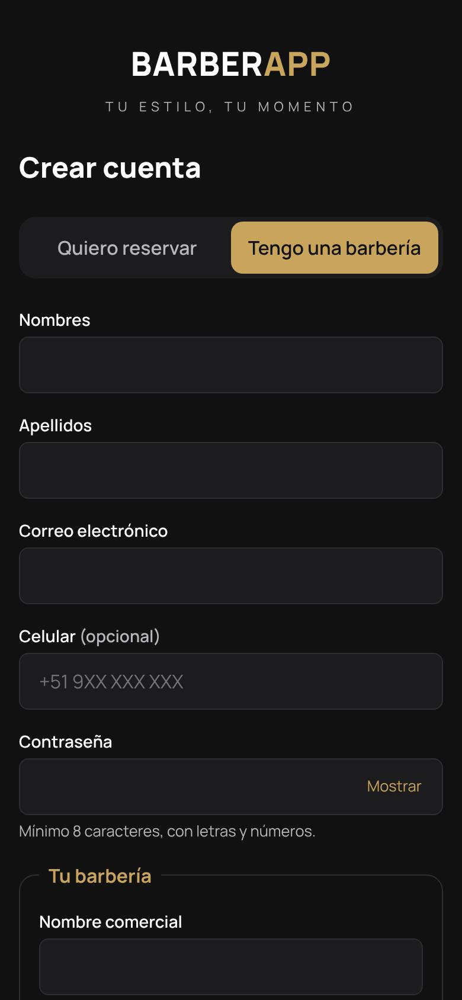

1. En **Crear cuenta** elige **Tengo una barbería**.
2. Completa tus datos (nombres, apellidos, correo, celular opcional y contraseña de al menos 8 caracteres con letras y números).
3. En **Tu barbería** escribe el **nombre comercial**. Si quieres, elige el **enlace de reservas** (por ejemplo `la-navaja`, que será `…/b/la-navaja`) y tu **RUC**.
4. Acepta los términos y la política de privacidad, y toca **Crear cuenta**.
5. **Verifica tu correo** con el enlace que te llega. Es necesario para invitar personas y para pagar la suscripción.

**Aprobación.** El equipo de BARBERAPP revisa cada barbería nueva. Mientras tanto aparece como *pendiente*: puedes entrar al panel y configurarlo todo, pero aún no se publica ni recibe reservas. Te avisamos por la app y por correo cuando quede aprobada o si falta algo. Si la plataforma no exige aprobación, la barbería queda activa al instante.

**Prueba gratuita.** Al quedar activa empieza una prueba del plan que defina la plataforma (por defecto, Profesional por 14 días). Mira la sección [Suscripción](#14-suscripción-y-pagos).

 

## 2. Lista para recibir reservas: primeros pasos

Tu barbería aparece en el marketplace y acepta reservas cuando cumple las cuatro condiciones que muestra **Perfil público → Visibilidad en el marketplace**:

| Paso | Dónde | Qué hacer |
|---|---|---|
| 1 | **Sucursales** | Registra al menos una sede, con dirección, distrito, ubicación y **horario de atención** por día. |
| 2 | **Servicios** | Crea tus servicios con duración y precio. Agrúpalos en categorías (*Cortes*, *Barba*…). |
| 3 | **Barberos** | Registra a cada barbero, su sucursal principal, los **servicios que realiza** y su **jornada semanal con descansos**. |
| 4 | **Configuración** | Revisa las reglas de reserva: anticipación mínima, hasta cuándo se puede reservar, intervalos y plazo de cancelación. |
| 5 | **Perfil público** | Sube el logo, la portada y las fotos, escribe una descripción y tus datos de contacto. Activa **Publicar en el marketplace**. |
| 6 | **Avisos** | Ajusta los recordatorios para tus clientes. |

Aunque no publiques la barbería en el marketplace, tus clientes siempre pueden reservar con tu **enlace directo** o tu **QR**.

## 3. Inicio: el resumen del día

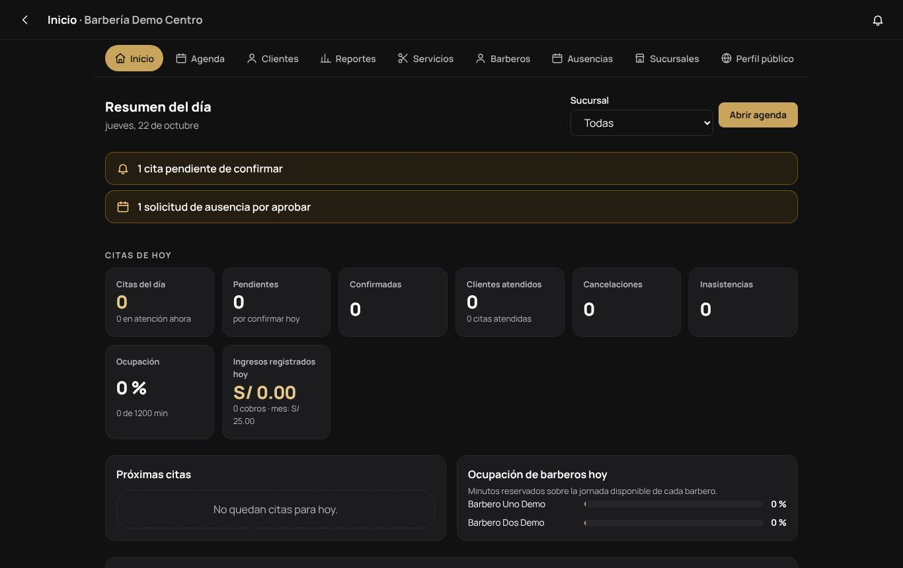

**Inicio** muestra, para todas las sedes o para la que elijas:

- **Avisos** que necesitan tu atención: citas pendientes de confirmar y solicitudes de ausencia por aprobar. Al tocarlos vas directo a la pantalla correspondiente.
- **Citas de hoy:** total, pendientes, confirmadas, clientes atendidos, cancelaciones e inasistencias.
- **Ocupación:** minutos reservados sobre los minutos de jornada disponibles.
- **Ingresos registrados hoy:** solo lo que se cobró de verdad (ver [Cobros](#5-cobros)). El precio de una cita que aún no se cobra **no** cuenta como ingreso.
- **Próximas citas** del día y **ocupación de cada barbero**.

## 4. Agenda

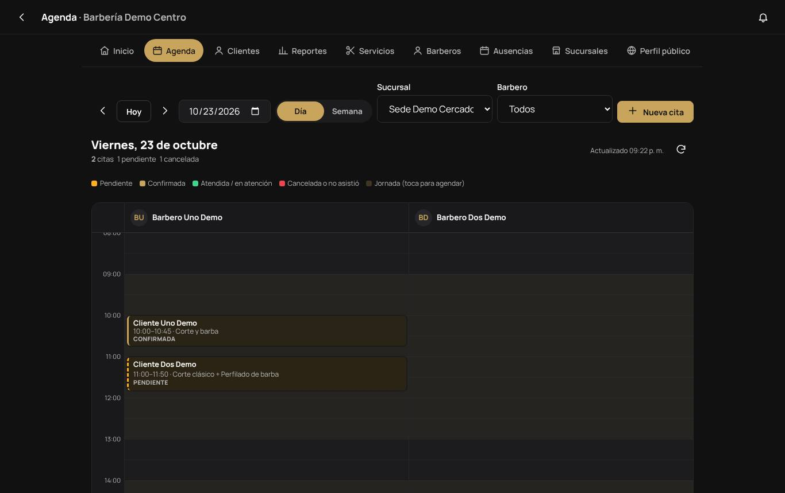

La **Agenda** muestra una columna por barbero con su jornada (fondo claro: toca un espacio libre para agendar ahí). Puedes:

- Moverte de día con las flechas, **Hoy** o el calendario, y cambiar entre **Día** y **Semana**.
- Filtrar por **sucursal** y por **barbero**.
- Leer el estado de cada cita por su color: pendiente, confirmada, atendida o en atención, cancelada o no asistió.

La agenda se actualiza sola cada minuto mientras la tienes abierta, así ves las reservas que llegan desde la app.

**Nueva cita (reserva de mostrador o por teléfono).** Toca **Nueva cita** o un espacio libre. Elige el cliente o regístralo en el momento (basta nombre y teléfono o correo; si ya existe, se usa su ficha), los servicios, el barbero, el día y la hora. El panel solo ofrece horas realmente libres y usa el mismo control que la app, así que **no se pueden cruzar dos citas del mismo barbero**. Desde el panel puedes agendar sin anticipación mínima y hasta un año adelante, pero nunca en el pasado.

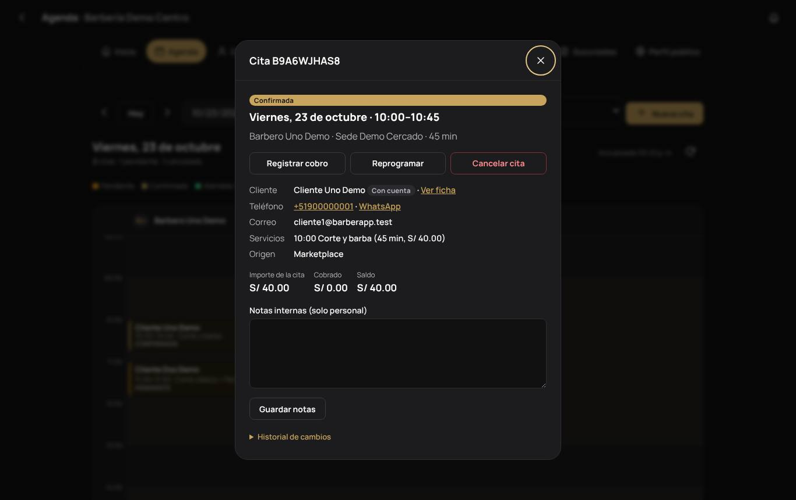

**Detalle de la cita.** Al tocar una cita ves cliente (con enlace a su ficha, teléfono y WhatsApp), servicios, origen (marketplace, enlace, QR, app o panel), importe, lo cobrado y el saldo. Los botones cambian según el momento:

| Acción | Cuándo |
|---|---|
| **Confirmar** | Citas pendientes. El cliente recibe un aviso. |
| **Iniciar atención** / **Marcar atendida** | Desde 30 minutos antes del inicio. |
| **No asistió** | Desde la hora de inicio, si no se inició la atención. Durante 7 días se puede corregir entre *atendida* y *no asistió*, salvo que la cita tenga cobros. |
| **Reprogramar** | Elige nuevo día, hora o barbero. La cita original se mantiene hasta que el nuevo horario queda confirmado. |
| **Cancelar cita** | Pide un motivo, que recibe el cliente. El horario se libera al instante. |
| **Registrar cobro** | Ver [Cobros](#5-cobros). |

Las **notas internas** solo las ve el personal. **Historial de cambios** muestra quién hizo cada cosa y cuándo.

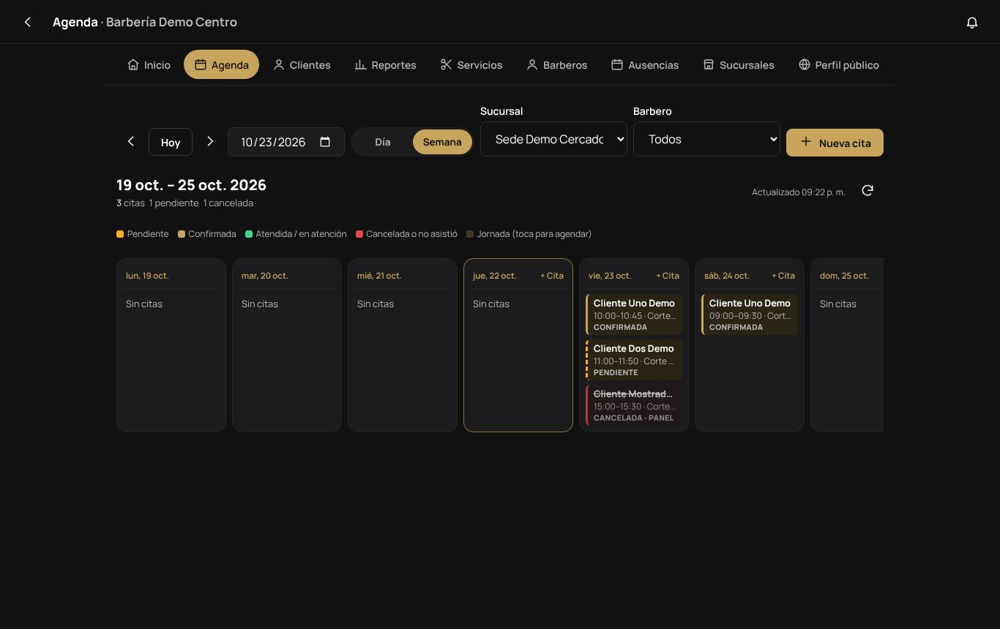

## 5. Cobros

BARBERAPP no cobra a tus clientes: el pago se hace en el local. El panel te ayuda a **registrar** lo que cobraste para que tus reportes sean reales.

- En el detalle de la cita, **Registrar cobro**: monto, método (efectivo, tarjeta, Yape, Plin, transferencia u otro) y número de operación si lo hay.
- Si cobras más que el importe de la cita, el panel te pide confirmarlo.
- Un cobro **no se borra**: si te equivocaste o devolviste el dinero, **anúlalo** con un motivo. Queda en el historial.
- No se registran cobros de citas canceladas o marcadas como *no asistió*.

**Ingresos = suma de cobros no anulados.** Solo el propietario ve los ingresos; el administrador no.

## 6. Clientes

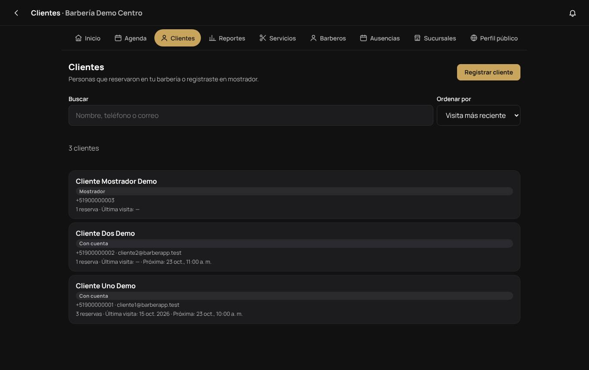

**Clientes** lista a quienes reservaron en tu barbería o registraste en mostrador. Puedes buscar por nombre, teléfono o correo y ordenar por recientes, nombre o cantidad de reservas.

La **ficha** de cada cliente muestra sus próximas citas, el historial, cuántas veces vino, sus servicios y barbero frecuentes y el total cobrado. También puedes:

- Escribir **observaciones internas** (solo las ve el personal).
- **Bloquear la reserva en línea** de esa persona: no podrá reservar desde la app, pero tú sí puedes agendarle desde el panel.
- **Registrar cliente** de mostrador, aunque no tenga cuenta. Si luego crea una cuenta con el mismo correo y lo verifica, verá esas citas en su app.

Solo puedes cambiar el teléfono o el correo de los clientes de mostrador. Los que tienen cuenta los gestionan ellos mismos.

## 7. Servicios, barberos y sucursales

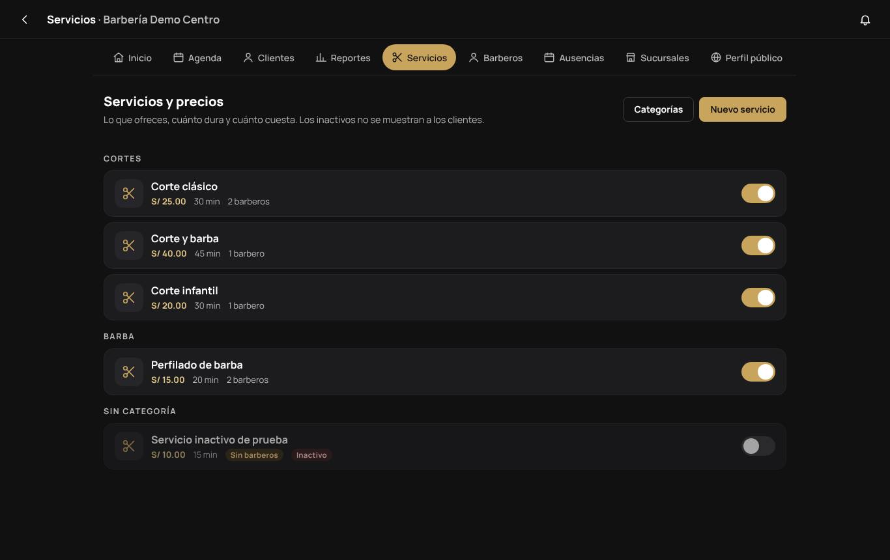

**Servicios.** Cada servicio tiene nombre, duración, precio, categoría, **tipo** (sirve para los filtros del marketplace) y descripción opcional. Los barberos que lo realizan se eligen en la ficha de cada barbero. El interruptor lo activa o lo desactiva: los inactivos no se muestran a los clientes. **Categorías** ordena los grupos. Un servicio sin barberos asignados no se puede reservar.

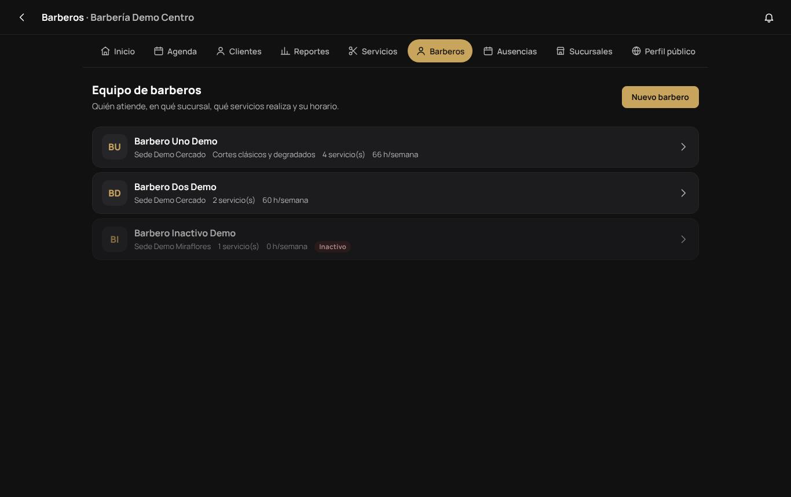

**Barberos.** **Nuevo barbero** pide el nombre visible, la especialidad, la sucursal principal y, opcionalmente, una **cuenta de acceso**. Sin cuenta, el barbero es solo una columna de la agenda. Con cuenta, entra a su propio panel móvil ([Manual del barbero](BARBERO.md)).

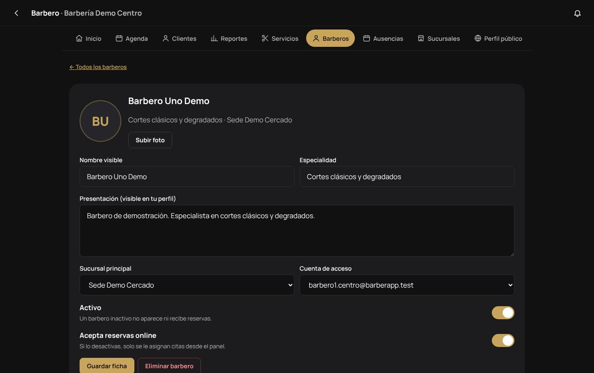

En la **ficha** de cada barbero:

- Foto, presentación (visible en tu perfil público) y cuenta vinculada.
- **Activo:** un barbero inactivo no aparece ni recibe reservas.
- **Acepta reservas online:** si lo apagas, solo se le asignan citas desde el panel.
- **Servicios que realiza**, con precio o duración propios si son distintos.
- **Jornada semanal y descansos** por día y sucursal (por ejemplo, de 09:00 a 20:00 con almuerzo de 13:00 a 14:00).
- **Así se verá su disponibilidad:** una vista previa de los horarios que verán los clientes.

No puedes eliminar a un barbero ni desactivarlo si tiene citas futuras: el panel te pide reprogramarlas o cancelarlas primero.

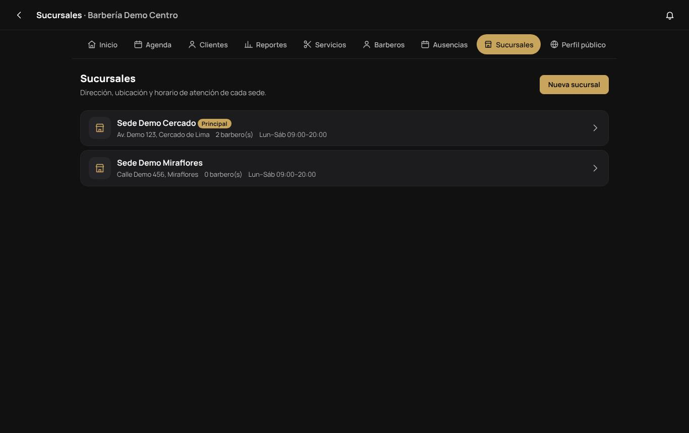

**Sucursales.** Nombre, dirección y referencia, distrito, provincia y departamento, teléfono, correo, ubicación (latitud y longitud, para la búsqueda *Cerca*), zona horaria y **horario de atención** de cada sede. Un barbero nunca trabaja fuera del horario de su sede. La cantidad de sucursales y de barberos activos depende de tu plan.

## 8. Ausencias y vacaciones

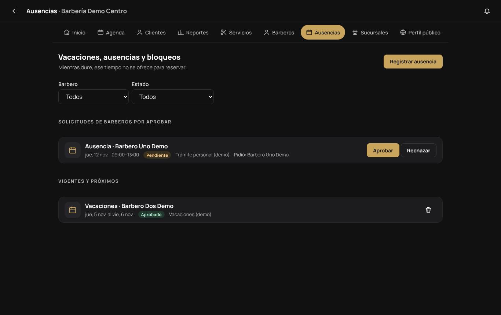

Mientras dure una ausencia, ese tiempo **no se ofrece para reservar**.

- **Registrar ausencia:** vacaciones, ausencia, descanso puntual, bloqueo o **feriado** (para toda la barbería o una sede), por día completo o por horas. Si ya hay citas en ese rango, el panel te las muestra para que las reprogrames.
- **Solicitudes de barberos por aprobar:** los barberos piden sus ausencias desde su panel. Tú las **apruebas** o **rechazas** con un comentario opcional, que el barbero ve.
- En **Configuración → Equipo: panel del barbero** decides si sus ausencias necesitan tu aprobación y si pueden editar su propia jornada. Por defecto necesitan aprobación y no pueden editar la jornada.

## 9. Avisos a tus clientes

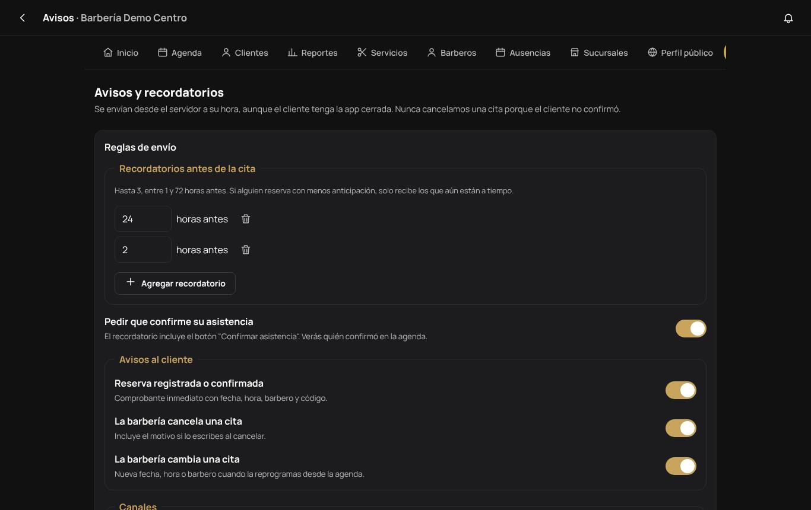

Los avisos salen del servidor a su hora, aunque el cliente tenga la app cerrada:

- **Recordatorios antes de la cita:** hasta 3, entre 1 y 72 horas antes (por defecto 24 h y 2 h).
- **Pedir que confirme su asistencia:** el recordatorio incluye un botón para confirmar, y en la agenda verás quién confirmó. **Nunca se cancela una cita porque el cliente no confirmó.**
- **Avisos al cliente:** reserva registrada o confirmada, cancelación hecha por la barbería (con el motivo) y cambios de fecha, hora o barbero.
- **Canales:** bandeja de la app, notificación push y correo, según lo que incluya tu plan.

Más abajo, **Resultados** muestra para los últimos 7, 30 o 90 días los recordatorios por canal, las confirmaciones, la tasa de inasistencia y los últimos errores de envío.

## 10. Reportes

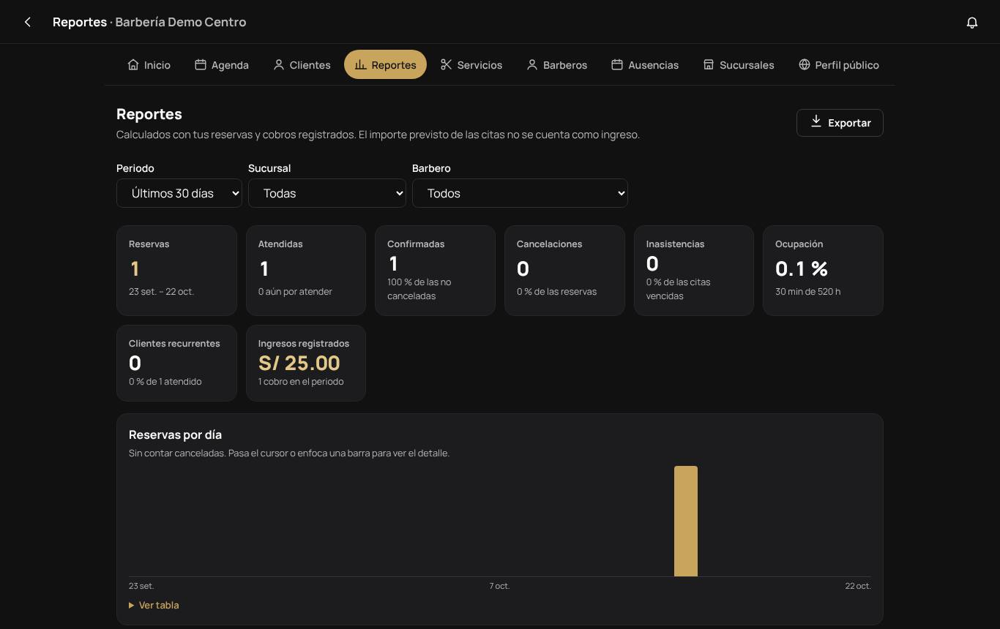

**Reportes** calcula todo con tus reservas y cobros registrados, por periodo, sucursal y barbero:

- Reservas, atendidas, confirmadas, cancelaciones e inasistencias, con sus porcentajes.
- Ocupación, clientes recurrentes e ingresos registrados.
- Reservas por día, servicios más pedidos, demanda por día y hora, productividad por barbero, importe previsto frente a cobrado y evolución mensual.

Cada gráfico tiene **Ver tabla** con los números exactos. **Exportar** descarga el resumen o el detalle de reservas en **CSV** o **Excel**, o abre una versión para imprimir o guardar como **PDF**.

En el plan Básico el periodo máximo es de 31 días y no incluye ocupación ni evolución mensual. La pantalla te lo indica.

## 11. Roles del equipo

| Puede… | Propietario | Administrador | Barbero |
|---|:-:|:-:|:-:|
| Ver la agenda de toda la barbería | ✓ | ✓ | solo la suya |
| Agendar, confirmar, cancelar, reprogramar | ✓ | ✓ | confirmar y atender lo suyo |
| Registrar cobros | ✓ | ✓ | |
| Ver clientes y escribir notas | ✓ | ✓ | notas de sus citas |
| Reportes operativos | ✓ | ✓ | |
| Ver ingresos | ✓ | | |
| Servicios, horarios y ausencias del equipo | ✓ | ✓ | pedir sus ausencias |
| Avisos y recordatorios | ✓ | ✓ | |
| Barberos y sucursales | ✓ | | |
| Perfil público, reglas de reserva, suscripción, equipo | ✓ | | |

El detalle completo está en [MATRIZ_ACCESO.md](../MATRIZ_ACCESO.md).

**Sumar a alguien al equipo.** La persona crea su cuenta en BARBERAPP y verifica su correo. Luego la invitas como administrador o barbero, y ella acepta la invitación en **Mi cuenta → Mis barberías**. Una vez aceptada como barbero, la vinculas a su ficha en **Barberos → Cuenta de acceso**.

> **Limitación conocida:** en esta versión el panel todavía no tiene pantalla para enviar invitaciones. La invitación se hace con la API (`POST /api/v1/panel/personal`, permiso `personal.gestionar`; ver [API.md](../API.md)). La lista del equipo y la revocación de accesos usan la misma API. Aceptar o rechazar la invitación sí está en la app.

## 12. Perfil público, enlace y QR

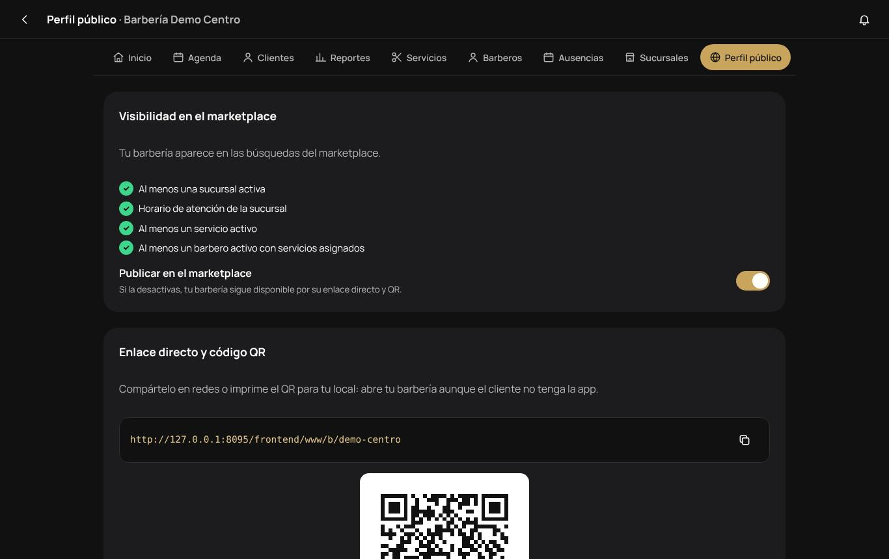

- **Visibilidad en el marketplace:** la lista de requisitos y el interruptor **Publicar en el marketplace**. Si lo apagas, tu barbería sigue disponible por su enlace directo y su QR.
- **Enlace directo y código QR:** cópialo para tus redes y WhatsApp, o descarga el QR para imprimirlo en el local.
- **Imágenes:** logo, portada y galería de fotos.
- **Descripción y contacto:** texto de presentación, teléfono, WhatsApp, Instagram, TikTok, Facebook y sitio web.

## 13. Configuración y reglas de reserva

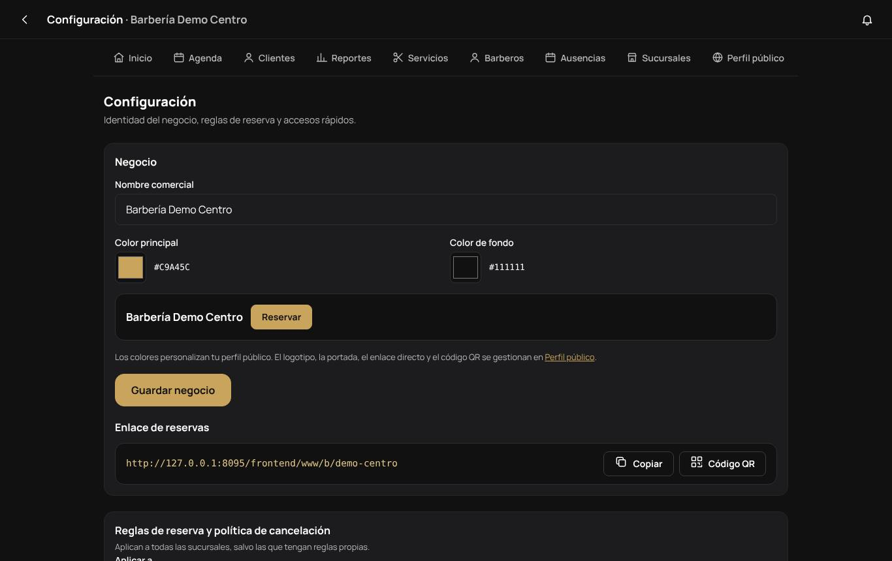

- **Negocio:** nombre comercial y colores de tu perfil público (los colores propios dependen de tu plan), con vista previa. **Enlace de reservas** para copiar o ver su QR.
- **Reglas de reserva y política de cancelación**, generales o propias de una sucursal:
  - Anticipación mínima para reservar y cuántos días hacia adelante se puede.
  - Intervalo de la grilla de horas y margen entre citas.
  - Hasta cuántas horas antes el cliente puede cancelar o reprogramar en línea (por defecto 2 h) y cuántas veces puede reprogramar (por defecto 2).
  - Citas activas máximas por cliente y si las reservas quedan confirmadas al instante o pendientes de tu confirmación.
  - Si se permite elegir *Cualquier barbero disponible*.
  - Texto de tu política de cancelación, que el cliente ve antes de confirmar.
- **Equipo: panel del barbero:** si sus ausencias requieren aprobación y si pueden editar su jornada.
- Accesos rápidos a sucursales, horarios y equipo.

## 14. Suscripción y pagos

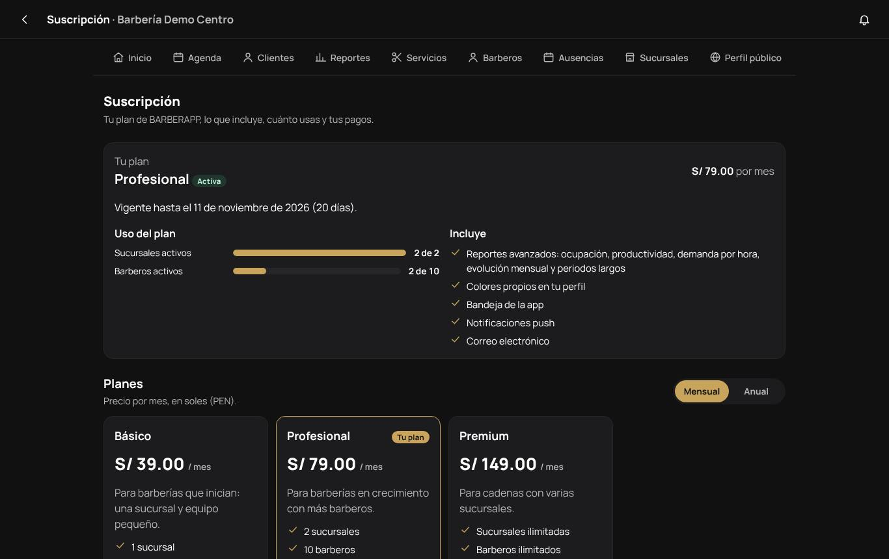

**Suscripción** muestra tu plan, su estado (prueba, activa, vencida), la fecha de vigencia, cuánto usas de sus límites (sucursales y barberos activos) y lo que incluye. Más abajo están los planes, con precios mensuales o anuales, y tu historial de pagos.

| Plan | Mensual | Sucursales | Barberos | Reportes avanzados | Colores propios | Canales |
|---|---|---|---|---|---|---|
| Básico | S/ 39 | 1 | 3 | No | No | Bandeja y push |
| Profesional | S/ 79 | 2 | 10 | Sí | Sí | Bandeja, push y correo |
| Premium | S/ 149 | Sin límite | Sin límite | Sí | Sí | Bandeja, push y correo |

Son los precios del seeder. La plataforma puede cambiarlos; tu precio pactado no cambia hasta que renueves.

**Pagar.** Elige el plan, el ciclo y cuántos periodos, y toca **Pagar**. Antes de pagar ves el monto exacto. El pago se hace en la página de **Mercado Pago**: BARBERAPP nunca recibe ni guarda los datos de tu tarjeta. Al confirmarse, tu plan se actualiza solo. Si pagas durante la prueba, el periodo pagado empieza cuando la prueba termina, así no pierdes días.

- **Mejorar el plan** se cobra solo por el tiempo que falta del periodo y se aplica al instante.
- **Bajar de plan** o cambiar de ciclo se programa para el final del periodo pagado, sin cobro, y se puede anular. Si usas más sucursales o barberos de los que permite el plan nuevo, primero desactiva lo que sobra.
- La plataforma también puede registrar pagos por transferencia u otros medios.

**Vencimiento.** Recibes avisos 7, 3 y 1 día antes de que venza. Pasados unos días de gracia sin pago (3 por defecto), la barbería queda **restringida**: deja de aparecer y de recibir reservas nuevas, pero **conservas todo**, puedes atender y cobrar las citas ya agendadas, y la restricción se levanta en cuanto se confirma el pago.

## 15. Preguntas frecuentes

| Pregunta | Respuesta |
|---|---|
| Mi barbería no aparece en el marketplace | Revisa **Perfil público → Visibilidad**: falta una sede activa con horario, un servicio activo, un barbero con servicios, la publicación está apagada, la barbería espera aprobación o la suscripción está restringida. |
| Un barbero no tiene horarios para reservar | Revisa su jornada, que tenga servicios asignados, que esté activo y que acepte reservas online, y si tiene ausencias en esas fechas. |
| ¿Puedo agendar una cita encima de otra? | No. Ni desde la app ni desde el panel se cruzan dos citas del mismo barbero. |
| Me equivoqué al cobrar | Anula el cobro con un motivo y registra el correcto. |
| Marqué "no asistió" por error | Durante 7 días puedes corregirlo a *atendida*, si la cita no tiene cobros. |
| No puedo agregar otra sucursal o barbero | Llegaste al límite de tu plan. Mejóralo en **Suscripción**. |
| ¿Por qué el administrador no ve los ingresos? | Los ingresos son información financiera: solo los ve el propietario. |
| Un cliente reserva y no viene | Revisa su ficha: puedes bloquear su reserva en línea y seguir agendándole tú. |
