# Manual del superadministrador

Cómo operar la plataforma BARBERAPP: aprobar barberías, gestionar planes, suscripciones y cobros, administrar cuentas, atender solicitudes de datos personales y revisar la auditoría. El panel de la plataforma está pensado para la computadora, pero también funciona en la tablet y en el teléfono.

> Las capturas son de la instalación de demostración (`php bin/console db:seed --demo`): barberías "Demo …" y cuentas `@barberapp.test`. Las cifras incluyen esos datos de demostración, como avisa el propio panel. No son datos reales. Se regeneran con `node scripts/capturas-manuales.mjs` desde `frontend/`.

## Contenido

1. [Acceso y roles de la plataforma](#1-acceso-y-roles-de-la-plataforma)
2. [Dashboard](#2-dashboard)
3. [Barberías](#3-barberías)
4. [Planes](#4-planes)
5. [Suscripciones](#5-suscripciones)
6. [Pagos](#6-pagos)
7. [Usuarios](#7-usuarios)
8. [Avisos (plantillas)](#8-avisos-plantillas)
9. [Reportes](#9-reportes)
10. [Auditoría](#10-auditoría)
11. [Privacidad: solicitudes ARCO](#11-privacidad-solicitudes-arco)
12. [Configuración de la plataforma](#12-configuración-de-la-plataforma)
13. [Tareas periódicas](#13-tareas-periódicas)

## 1. Acceso y roles de la plataforma

La primera cuenta de superadministrador de un servidor nuevo se crea por consola (ver [DESPLIEGUE.md](../DESPLIEGUE.md)):

```bash
sudo -u barberapp php bin/console plataforma:superadmin tu@correo.pe --nombre="Tu nombre"
```

Luego se entra con esa cuenta y se abre **Mi cuenta → Abrir panel de la plataforma**.

| Rol | Puede | No puede |
|---|---|---|
| **Superadministrador** | Todo el panel de la plataforma | Ver clientes, citas o teléfonos de las barberías |
| **Operador** | Barberías, suscripciones, pagos, reportes, auditoría y solicitudes de privacidad | Planes, plantillas de avisos, configuración ni roles |

Los roles se asignan en **Usuarios**, solo a cuentas activas con correo verificado. Cambiar el rol de alguien o bloquearlo cierra todas sus sesiones. Nadie puede cambiarse el rol ni bloquearse a sí mismo, y siempre debe quedar al menos un superadministrador activo.

**Privacidad por diseño.** La plataforma no tiene permisos dentro de las barberías: ve cifras agregadas (sucursales, barberos y reservas como números), nunca la agenda ni los datos de sus clientes.

## 2. Dashboard

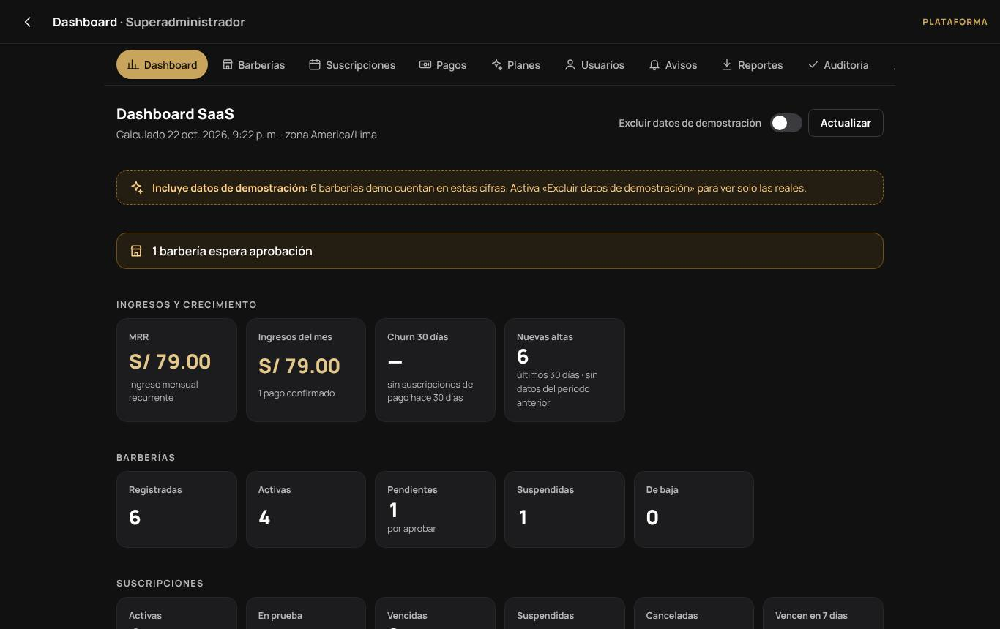

- **Avisos:** barberías que esperan aprobación y otras tareas pendientes.
- **Ingresos y crecimiento:**
  - **MRR:** suma de los precios pactados de las suscripciones activas vigentes; las anuales cuentan como su doceava parte y las pruebas no suman.
  - **Ingresos del mes:** pagos confirmados.
  - **Churn de 30 días:** suscripciones de pago que estaban vigentes hace 30 días y ya no lo están, sin otra vigente hoy. Si no hay base de comparación muestra «—».
  - **Nuevas altas** de los últimos 30 días.
- **Barberías** por estado, **suscripciones** por estado (y cuántas vencen en 7 días), reservas agregadas y **consumo por plan**, que indica cuántas barberías superan los límites de su plan.
- **Estado del sistema:** base de datos, tareas programadas y cola de avisos.

Las barberías de demostración se incluyen por defecto y el panel lo advierte. El interruptor **Excluir datos de demostración** las quita de todas las cifras.

## 3. Barberías

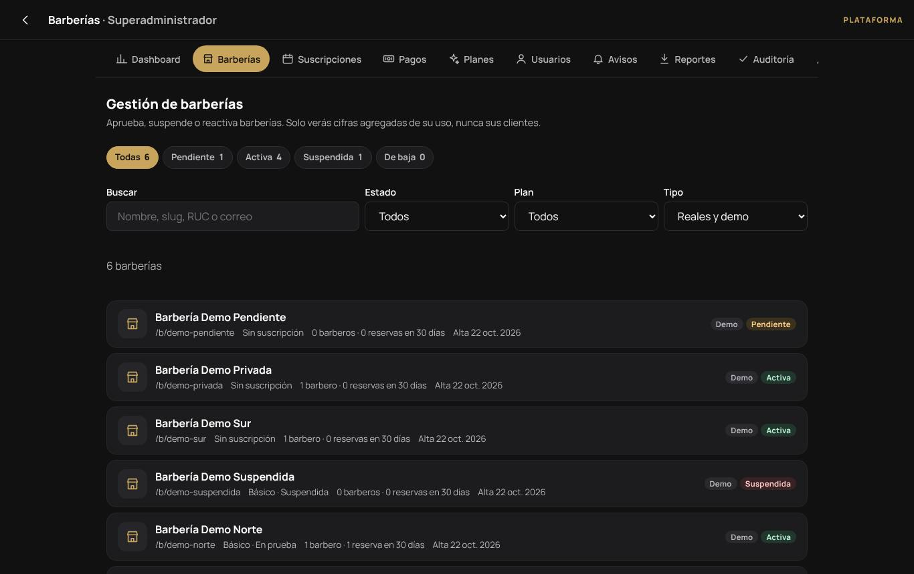

La lista se puede filtrar por estado (pendiente, activa, suspendida, de baja), plan y tipo (reales o demo), y buscar por nombre, enlace, RUC o correo. La ficha de cada barbería muestra sus datos, propietarios, suscripción y uso agregado.

| Acción | Efecto |
|---|---|
| **Aprobar** | La barbería pasa a activa, empieza su prueba gratuita y se publica si cumple los requisitos. |
| **Rechazar** (con motivo) | Queda de baja. |
| **Suspender** (con motivo) | Sale del marketplace y deja de recibir reservas nuevas. **No** cancela las citas ya agendadas. Su equipo sigue entrando al panel y ve un aviso con el motivo y el correo de soporte. |
| **Reactivar** | Vuelve a estar activa. |

Cada cambio avisa a los propietarios por la app y por correo, y queda en la auditoría. Si en **Configuración** se desactiva *Aprobar manualmente las nuevas barberías*, las nuevas nacen activas.

## 4. Planes

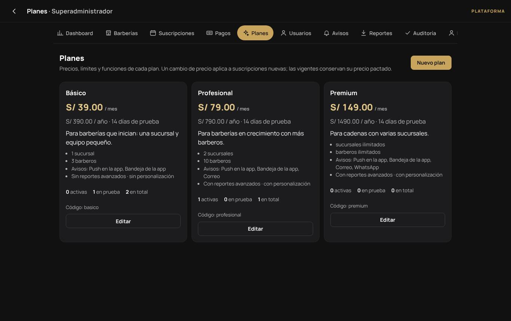

Cada plan tiene precio mensual y anual, días de prueba, límite de sucursales y de barberos (vacío = sin límite), funciones (reportes avanzados, colores propios) y canales de aviso (bandeja, push, correo). Se puede crear un plan nuevo o desactivar uno para que no se ofrezca.

Cambiar el precio de un plan **no** cambia lo que pagan las barberías que ya lo tienen: rige para las contrataciones nuevas y para las renovaciones a precio de lista.

## 5. Suscripciones

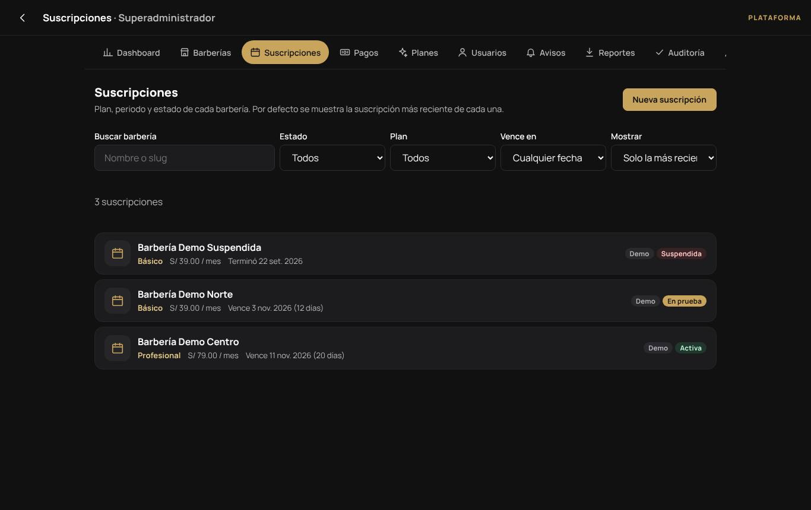

Cada barbería tiene a lo sumo una suscripción vigente. Desde la ficha de una suscripción puedes **cambiar de plan** (conserva el periodo), **renovar** (extiende desde el fin actual, o empieza hoy si ya venció), **suspender**, **reactivar**, **cancelar** y **registrar un pago**. Cada cambio queda en el historial de la suscripción con el antes y el después.

También puedes crear una suscripción para una barbería sin suscripción o con la anterior terminada.

## 6. Pagos

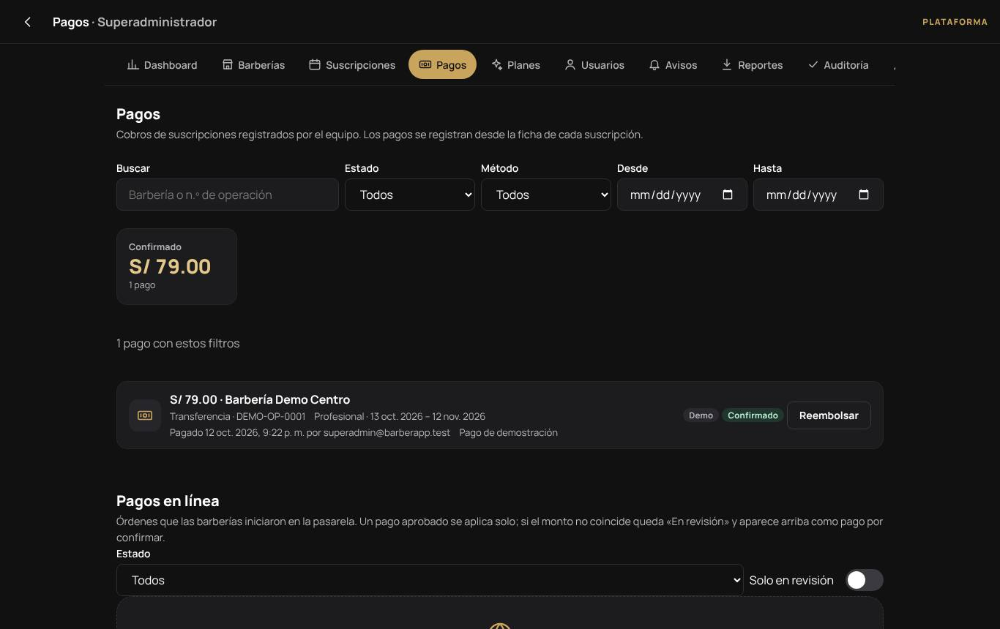

- **Pagos:** cobros de suscripciones con estado, método, número de operación, periodo y quién los registró. Se filtran por barbería, estado, método y fechas.
- **Registrar un pago manual** (transferencia, Yape, etc.) se hace desde la ficha de la suscripción. Un pago confirmado con periodos renueva la suscripción. El número de operación no se puede repetir para el mismo método.
- **Confirmar** o **rechazar** los pagos pendientes, y **reembolsar** uno confirmado. Un reembolso no acorta el periodo; si corresponde, suspende o cancela la suscripción después.
- **Pagos en línea:** órdenes que las barberías iniciaron en Mercado Pago. Un pago aprobado se aplica solo. Si el monto no coincide, la orden queda **En revisión** y aparece arriba como pago por confirmar.

## 7. Usuarios

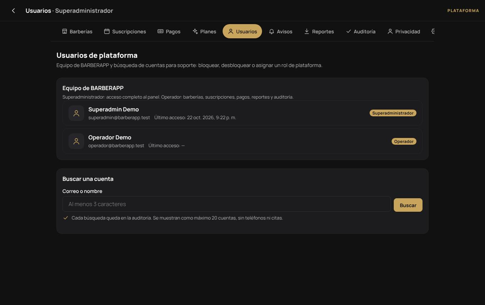

- La lista muestra al equipo de la plataforma (superadministradores y operadores).
- **Buscar** cualquier cuenta pide al menos 3 caracteres y devuelve como máximo 20 resultados, sin teléfonos ni citas. **Cada búsqueda y cada ficha consultada quedan en la auditoría.**
- **Bloquear** o **desbloquear** una cuenta (bloquear cierra todas sus sesiones) y **asignar o quitar el rol** de plataforma.

## 8. Avisos (plantillas)

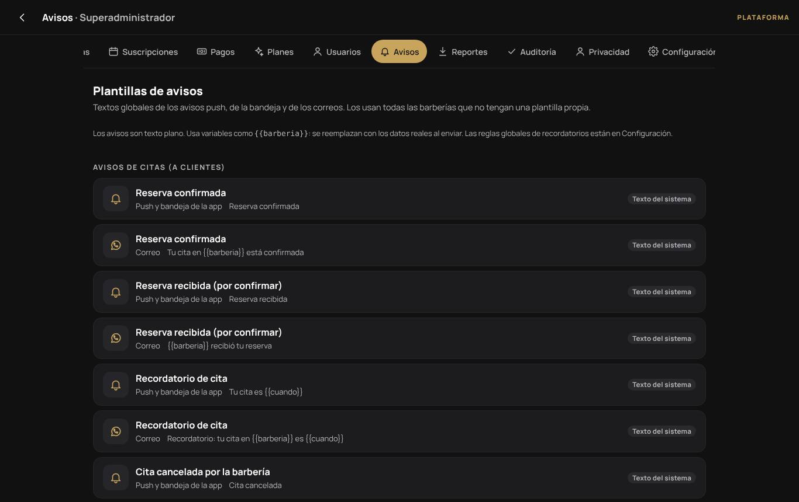

Los textos de las notificaciones push y de los correos que envía la plataforma: recordatorios, confirmaciones, cancelaciones, avisos de suscripción y cambios de estado de las barberías. Puedes editar cada plantilla por canal, usar las variables que lista la pantalla y ver una **vista previa** con datos de ejemplo. **Restaurar texto del sistema** vuelve al texto original.

## 9. Reportes

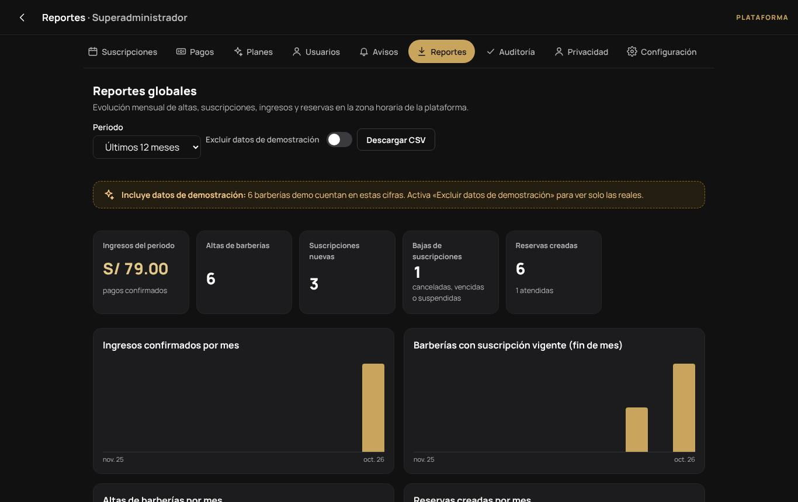

Evolución mensual de 1 a 24 meses: altas de barberías, suscripciones, ingresos confirmados, MRR y reservas agregadas. Puedes excluir los datos de demostración y **descargar el CSV**. Los meses se cortan en la zona horaria de la plataforma.

## 10. Auditoría

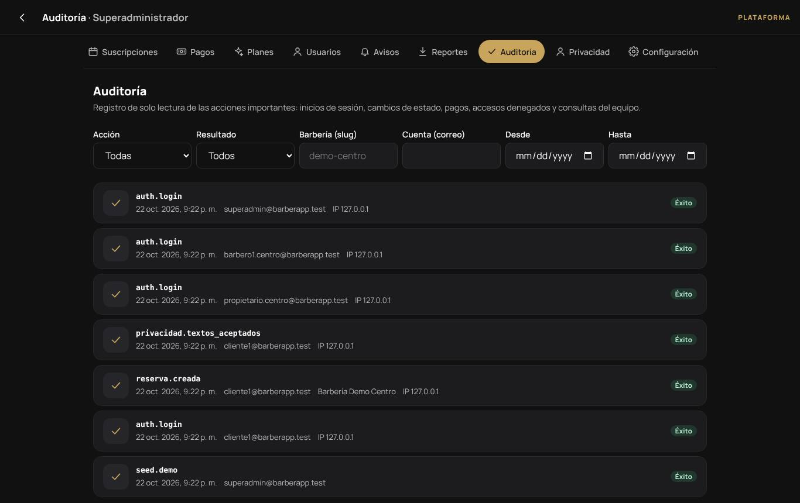

Registro de las acciones sensibles de toda la plataforma: inicios de sesión y fallos, cambios de permisos, aprobaciones y suspensiones, pagos, consultas de cuentas, eliminaciones de cuentas, accesos denegados, etc. Cada fila tiene fecha, cuenta, barbería, acción, resultado, IP y el identificador de la petición, que permite encontrarla en los registros del servidor. Se filtra por acción, resultado, barbería, usuario y fechas.

La auditoría solo se agrega: nadie puede editarla ni borrarla desde la aplicación. La política de retención la depura con el tiempo (ver [SEGURIDAD.md](../SEGURIDAD.md)).

## 11. Privacidad: solicitudes ARCO

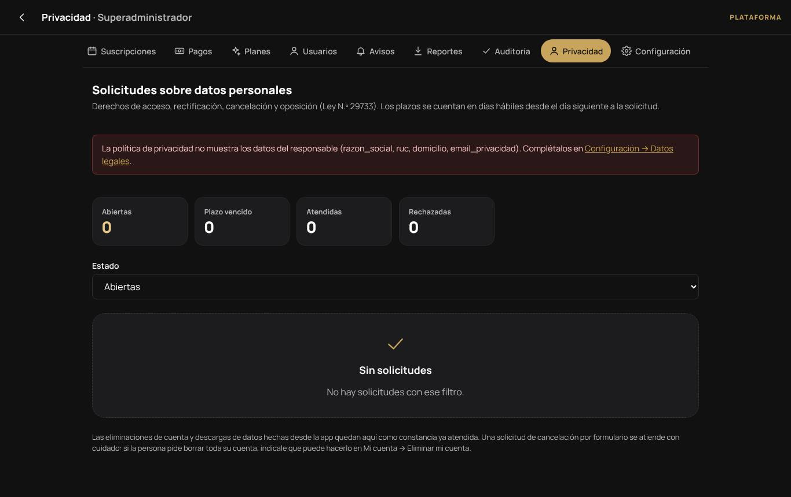

Bandeja de los derechos de **acceso, rectificación, cancelación y oposición** (Ley N.° 29733):

- Cada solicitud tiene un código, el tipo, la persona y su **plazo legal en días hábiles** (feriados del Perú incluidos). Los contadores muestran las abiertas, las de plazo vencido, las atendidas y las rechazadas.
- Respóndela como *En proceso*, *Atendida* o *Rechazada*, con un mensaje. La persona lo recibe por correo y en **Mi cuenta**, con la mención de que puede reclamar ante la Autoridad Nacional de Protección de Datos Personales. El plazo se puede ampliar una sola vez: responde *En proceso* y explica el motivo.
- Las descargas de datos y las eliminaciones de cuenta hechas desde la app aparecen aquí como constancias ya atendidas.

Si la pantalla muestra en rojo que faltan los **datos del responsable** (razón social, RUC, domicilio, correo de privacidad), complétalos en **Configuración → Datos legales**. Mientras falten, la política de privacidad pública lo indica en lugar de inventarlos.

## 12. Configuración de la plataforma

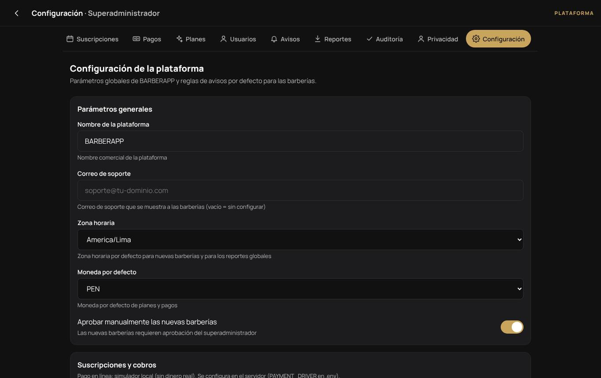

- **Parámetros generales:** nombre de la plataforma, **correo de soporte** (se muestra a las barberías suspendidas o pendientes), zona horaria y moneda por defecto, y si las barberías nuevas necesitan **aprobación manual**.
- **Suscripciones y cobros:** pasarela activa (se elige en el servidor con `PAYMENT_DRIVER`), prueba automática y su plan, días de gracia antes de restringir, si se restringe a las barberías sin suscripción y con cuántos días de anticipación se avisa el vencimiento.
- **Reglas de avisos por defecto** para las barberías que no las cambiaron.
- **Datos legales:** datos del responsable del tratamiento y código de inscripción del banco de datos en el registro de la ANPD. Los textos legales deben revisarse con un abogado antes de publicar.

## 13. Tareas periódicas

El panel depende de estas tareas del servidor, que el instalador deja programadas (ver [DESPLIEGUE.md](../DESPLIEGUE.md) y [BACKUPS.md](../BACKUPS.md)):

| Tarea | Frecuencia | Qué hace |
|---|---|---|
| `suscripciones:vencer` | cada hora | Aplica cambios de plan programados, marca vencimientos, restringe tras la gracia y avisa |
| `notificaciones:procesar` | permanente o cada minuto | Envía recordatorios y avisos |
| `privacidad:retencion` | diaria | Aplica la política de retención de datos |
| `backup:crear`, `backup:enviar`, `backup:verificar` | diaria y semanal | Copias cifradas, copia fuera del servidor y prueba de restauración |
| `monitor:revisar --alertar` | cada 5 minutos | Revisa el estado y avisa por correo si algo falla |

Si el dashboard muestra una tarea atrasada, revisa el servidor con `php bin/console monitor:revisar`.
